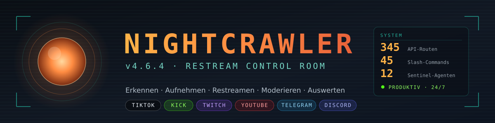
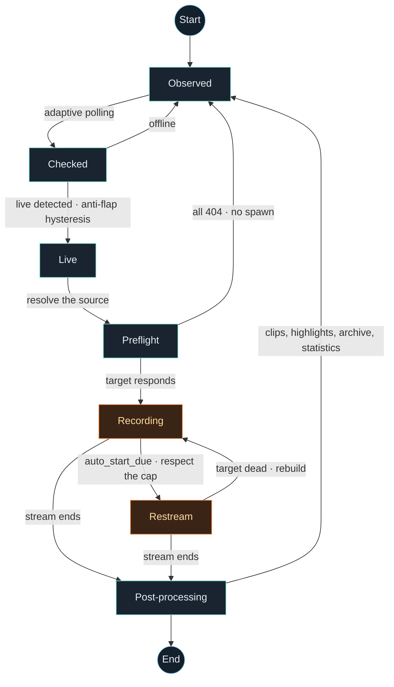
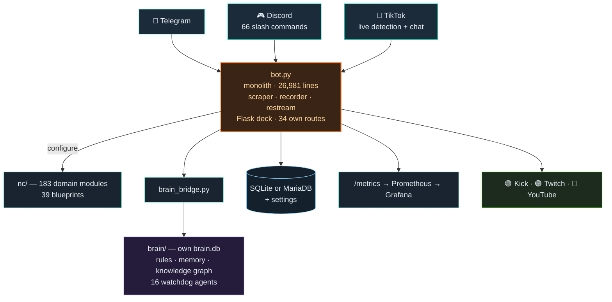
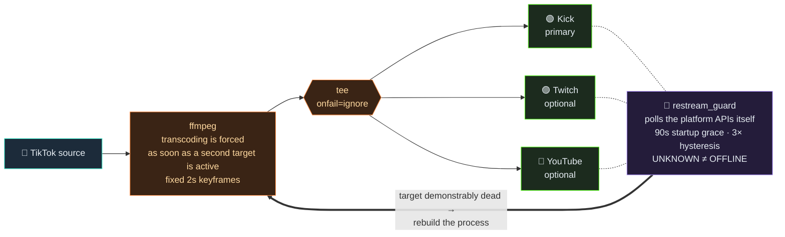

<div align="center">



### The control room for live streaming
#### Monitoring · Recording · Multi-target restream · AI moderation

🌐 **English** · [Deutsch](README.md) · [Español](README.es.md)

[](LICENSE)
[](https://www.python.org/)
[](../../actions/workflows/ci.yml)
[](../../actions/workflows/codeql.yml)
[](https://github.com/itsamemedev/Telegram-Stream-Info-Bot/releases/latest)

[](#️-operating-it)
[](#️-operating-it)
[](#-restream)
[](#️-database)
[](#-monitoring)
[](#️-dashboard)

[](https://lafap.de)
[](https://discord.gg/psvnxm7tSV)

<br>

> **A TikTok stream goes live → it is detected, recorded, restreamed to Kick,
> Twitch and YouTube, moderated and commented on in all three chats — fully
> automatic, on a single server, without a cloud subscription.**

</div>

### At a glance

| | |
|---|---|
| **What for** | Live monitoring, recording and multi-target restreaming of TikTok streams, with AI moderation on Kick, Twitch and YouTube |
| **For whom** | Operators who want this on **their own** hardware — one Linux server, no SaaS, no third-party platform between stream and targets |
| **Runs on** | Ubuntu/Debian with systemd, Python 3.12–3.14, ffmpeg, streamlink, yt-dlp — database SQLite or MariaDB |
| **Operated through** | Telegram, Discord (66 slash commands) and a web deck with four themes in German, English and Spanish — settings right in the deck |
| **Monitoring** | 16 watchdog agents, real-time situation map, Prometheus and Grafana with alert rules |
| **Quality** | over a thousand contracts, CI on three Python versions and against the frozen production state, `pip-audit`, CodeQL |
| **License** | GPL-3.0-or-later |

---

## 📋 Contents

- [✨ What NIGHTCRAWLER does](#-what-nightcrawler-does) · [🏗️ Architecture](#️-architecture)
- [📦 Installation](#-installation) · [🔄 Updating and extending](#-updating-and-extending)
- [⚙️ Settings](#️-settings) · [🗄️ Database](#️-database)
- [🕹️ Operating it](#️-operating-it) · [📡 Restream](#-restream) · [🧠 AZRAEL and the watchdogs](#-azrael-and-the-watchdogs)
- [🖥️ Dashboard](#️-dashboard) · [📈 Monitoring](#-monitoring) · [🚀 Operations](#-operations)
- [🛡️ Security](#️-security) · [🩺 Troubleshooting](#-troubleshooting) · [🧪 Development](#-development)
- [🆕 New in v4.6](#-new-in-v46) · [📊 Project status](#-project-status) · [🤝 Contributing](#-contributing) · [📄 License](#-license)

---

## ✨ What NIGHTCRAWLER does

| | | |
|---|---|---|
| **🔍 Detect** — adaptive polling with anti-flap hysteresis; every row in the deck says when it was last checked | **⏺️ Record** — three-stage recorder (ffmpeg → streamlink → yt-dlp) with preflight, audio-track check and stall detection | **📡 Restream** — Kick, Twitch and YouTube at once, target verification against the platform APIs |
| **🛡️ Moderate** — SENTINEL-SHIELD against doxxing and hate, deterministic and **before** any AI | **🤖 Talk along** — AZRAEL answers in three chats, reacts to the broadcast and appears in the picture | **📊 Evaluate** — deck with 379 API routes, knowledge graph, revenue journal with a hash chain, PWA |

<details>
<summary><b>🔎 Full feature list</b></summary>

<br>

| Area | Function |
|---|---|
| **Live detection** | Adaptive polling · anti-flap hysteresis · subscriber-stream detection · proxy/SOCKS support · cookie rotation |
| **Recording** | Three-stage recorder fallback · preflight GET before spawn · suffix fallback for CDN quirks · recording watchdog against frozen captures · S3 backup (optional) |
| **Restream** | Kick / Twitch / YouTube in parallel · `tee` with `onfail=ignore` · forced transcode with multiple targets · target verification through the platform APIs · resume after restart · safe test push without broadcast risk · cap on concurrent restreams |
| **Chat & moderation** | SENTINEL-SHIELD (doxxing / hate / threats) · shared moderation heuristic across Kick, Twitch, YouTube · foreign-advertising detection with an own-channel allowlist · banned words · timeout escalation |
| **AI (AZRAEL)** | Chat answers when addressed · live reactions to the broadcast · speech output (Piper) · persona system · multi-backend: Anthropic (with key) → local llama.cpp (preferred as soon as it runs) → free APIs · budget and tier control |
| **Brain (`brain/`)** | State machine · rule-based tier-1 decisions with a why-log · long-term memory · knowledge graph (triple store) · semantic search · forecasts · weekly report |
| **Sentinel fleet** | 16 watchdog agents (health, recovery, scout, analytics, learning, sentinel, disk, swap, restream, toxicity, uptime, recording, proxy, datenbank, prometheus, grafana) with Telegram alarms, individually switchable |
| **Community** | Recognition of regular viewers · loyalty points & ranks · Discord XP, levels, daily streak · live ping · highlight share · community events |
| **Money** | Donation telemetry (estimates) · separate revenue journal (`nc/ledger.py`) with a hash chain and CSV export for the tax office |
| **Dashboard** | 379 Flask routes · live panels · brain visualisation with a learning curve · overlay for OBS · installable PWA (Android) · QR login |
| **Operations** | systemd service · deploy script with pre-check and auto-rollback · self-test route · dead-man's report on process death · CrowdSec integration · log redaction for cookies and stream keys |
| **Multilingual** | German, English and Spanish, switchable in the dashboard · `UI_LANG` for the bot · browser language detection · translation catalogue in `locales/` |
| **Database** | SQLite **or** MariaDB · move with `update.sh --mariadb`, counted again · central schema module · export tool · database watchdog |
| **Settings** | “Settings” tab in the deck: all ~586 variables searchable, stored in the database, protected keys only from `.env` |
| **Monitoring** | `/metrics` for Prometheus · Grafana dashboard with every metric · 16 alert rules with tests · set up with `tools/observability.sh` |

</details>

### The life cycle of a stream



---

## 🏗️ Architecture



> [!IMPORTANT]
> `nc/*`, `brain/*` and `discordbot.py` **never** import from `bot.py`.
> Configuration comes in through `configure(...)` injection — this keeps the
> libraries testable in isolation and prevents circular imports.

---

## 📦 Installation

### Guided — one command

```bash
git clone https://github.com/itsamemedev/Telegram-Stream-Info-Bot.git ~/nightcrawler
bash ~/nightcrawler/tools/installer.sh        # --express = fewer questions, --unattended = none
```

On Windows: `tools\install.bat`. The script explains every step, asks before
each change, creates the venv and `.env`, installs the system packages, checks
the result with `bot.py --selfcheck` and, if you want, sets up autostart
(systemd with a dead-man's report, launchd, Task Scheduler). A second run brings
an existing installation up to date instead of overwriting it.

### By hand

```bash
git clone https://github.com/itsamemedev/Telegram-Stream-Info-Bot.git && cd Telegram-Stream-Info-Bot
python3 -m venv .venv && source .venv/bin/activate
pip install -r requirements.txt
sudo apt install -y ffmpeg streamlink yt-dlp
cp .env.example .env && nano .env      # at least BOT_TOKEN
python3 bot.py
```

Step by step, with OAuth and a local LLM: **[`docs/en/INSTALL.md`](docs/en/INSTALL.md)**.

| | Minimum | Recommended |
|---|---|---|
| **System** | Linux with systemd | Ubuntu 22.04 / 24.04 LTS |
| **Python** | 3.12 (PEP 701 — `bot.py` does not parse on 3.11) | 3.13 / 3.14 |
| **CPU · RAM** | 4 cores · 4 GB | 8 cores · 16 GB (transcode, local LLM) |
| **Disk · upload** | 20 GB · 10 Mbit | 200 GB+ · 50 Mbit+ |

---

## 🔄 Updating and extending

**Installing new code** goes through the update function — in the deck
(Overview → software state) or with Telegram `/update`. It fetches the state
from this repository and installs it file by file; then restart the service
(button in the deck). Until then `/healthz` reports the state as `veraltet`
(outdated).

**Installing what is missing** is the job of `tools/update.sh`:

```bash
bash tools/update.sh                 # guided: checks, shows the plan, asks about add-ons
bash tools/update.sh --check         # check only, exit code 1 if something is missing
bash tools/update.sh --dry-run       # show what would run
bash tools/update.sh --mariadb       # move the database from SQLite to MariaDB
```

In guided mode it asks about everything that is still missing: **Prometheus**
(with **Grafana**), optional Python packages and — if the database still lives
in SQLite — the move to **MariaDB**. Unattended and with `--check` it asks
nothing and triggers nothing; a schedule never silently moves a database.

---

## ⚙️ Settings

**In the deck, tab “Settings”.** All of the roughly 586 variables from
`.env.example` with group, default and description, searchable. Every row says
where the value comes from — *set in the deck*, *from .env* or *default*. Values
are stored in the database (SQLite or MariaDB) and take precedence over `.env`
at the next start:

```
deck (database)   ›   .env   ›   default in the code
```

- **“Import from .env”** copies `.env` into the database once — a button, not
  an automatism: if it ran silently at start, no later change to `.env` would
  ever take effect.
- **“Back to .env”** deletes an entry; the file applies again.
- The bot reads many values only at start — restart the service after saving
  (button in the tab).
- **Secrets** (tokens, keys, passwords) are write-only; the deck shows *whether*
  they are set, never the value.

> [!IMPORTANT]
> **`.env` only** — from the deck they would be a remote-control button for the
> server: the database connection (`DB_*`, `MARIADB_*`), deck access
> (`DASHBOARD_TOKEN`, `DASHBOARD_PIN`, `WEB_HOST`, port, TLS, `TRUSTED_PROXIES`)
> and anything that decides code, programs or paths (`UPDATE_*`, `*_CMD`,
> `*_BIN`, `*_DIR`, `*_PATH`). Such an entry in the database is ignored at
> start and reported.

**The minimum in `.env`:**

```ini
BOT_TOKEN=123456:ABC-DEF…            # Telegram bot from @BotFather
ADMIN_CHAT_ID=123456789              # your Telegram ID (alarms, admin commands)
```

OAuth: **[Twitch](docs/en/SETUP_TWITCH_OAUTH.md)** · **[YouTube](docs/en/SETUP_YT_OAUTH.md)** · Kick right in the deck.

> [!WARNING]
> **`.env` never belongs in the repository.** It contains cookies, OAuth tokens
> and stream keys; a secret committed once stays in the history forever.

---

## 🗄️ Database

| | SQLite (default) | MariaDB |
|---|---|---|
| **What for** | one file, no service, fast well into six-figure row counts | large datasets, several machines, separate backups |
| **Setup** | nothing | `bash tools/update.sh --mariadb` |

**The move** (`--mariadb`, `tools/zu_mariadb.py`) installs the server, creates
the database and user (the password never appears on a command line), stops the
bot briefly, moves **every table**, **counts again** and only then sets
`DB_BACKEND=mariadb` in `.env` — first it writes `.env.vor-mariadb-<time>`. A
non-empty target is never overwritten, and the bot starts again in any case.
Check beforehand: `venv/bin/python tools/zu_mariadb.py --dry-run`.

> [!TIP]
> **Way back:** the SQLite file stays untouched. Set `DB_BACKEND=sqlite` in
> `.env` and restart — done.

The **database watchdog** measures response time, size, growth, the SQLite
journal (`-wal`) and whether the schema matches the code, every five minutes.

---

## 🕹️ Operating it

### Telegram

Since v4.2-W109 every command lives in **one** registry
([`nc/befehle.py`](nc/befehle.py)) — Telegram and Discord register from it, and
`/help` builds its list from it on both platforms. The 29 shared commands have
**the same name on both platforms**; the former `sys_` names on Discord are gone.

| Command | Effect |
|---|---|
| `/tiktok` `‹name›` | Profile analysis of a TikTok account |
| `/live` `@user` | Check live status now |
| `/quelle` `‹name›` | Measure a live user's stream sources — every route, ffprobe, with the fix |
| `/track_exact` `‹name›` | Track the exact username (no correction) |
| `/pause` `@user` | Pause tracking |
| `/resume` `@user` | Resume tracking |
| `/unpause` `@user` | Re-enable an auto-paused source |
| `/bulkadd` `a b c` | Track several users at once |
| `/stoprec` `@user` | Stop a running recording cleanly |
| `/cleanup` | Clean up old recordings |
| `/quota` | Storage quota |
| `/teststream` `@user` | Recorder self-test |
| `/topusers` | Top streamers by recordings |
| `/summary` | Daily summary |
| `/aireset` | Reset AI context |
| `/brain` | Brain status: rules, agents, recommendations |
| `/report` | Azrael Sentinel weekly report |
| `/cookies` `[holen]` | Cookie status — use 'holen' to fetch them yourself |
| `/sysres` | System resources |
| `/logs` | Latest errors from the log |
| `/diag` | Full diagnostics |
| `/einnahmen` | Revenue and donations |
| `/about` | About this bot |
| `/tracklist` | Show tracked accounts |
| `/track` `‹name›` | Track a TikTok user |
| `/untrack` `‹name›` | Stop tracking a TikTok user |
| `/recstatus` | Running recordings |
| `/stats` | Statistics |
| `/ai` `‹frage›` | Ask AZRAEL |
| `/help` | Show all commands |
| `/start` | Start and quick overview (Telegram only) |
| `/update` | Install update from the repo (Telegram only) |

<details>
<summary><h3>Discord — 66 slash commands</h3></summary>

<br>

**Shared with Telegram** *(same name, same effect)*
`/tiktok` · `/live` · `/quelle` · `/track_exact` · `/pause` · `/resume` · `/unpause` · `/bulkadd` · `/stoprec` · `/cleanup` · `/quota` · `/teststream` · `/topusers` · `/summary` · `/aireset` · `/brain` · `/report` · `/cookies` · `/sysres` · `/logs` · `/diag` · `/einnahmen` · `/about` · `/tracklist` · `/track` · `/untrack` · `/recstatus` · `/stats` · `/ai` · `/help`

**Analysis**
`/status` · `/streaminfo`

**Tracking**
`/livenow` · `/restream_status` · `/follow` · `/unfollow`

**Recordings**
`/topstreamers` · `/clips` · `/clip` · `/clipoftheweek`

**AI and brain**
`/ask`

**System** *(admin role required)*
`/botstats` · `/post_test`

**Community**
`/rank` · `/leaderboard` · `/daily` · `/profile` · `/event` · `/events`

**Moderation**
`/warn` · `/warnings` · `/clearwarns` · `/purge` · `/kick` · `/ban` · `/timeout`

**Server** *(admin role required)*
`/setup_community` · `/setup_targets` · `/create_channel` · `/create_voice` · `/create_category` · `/create_role` · `/create_group` · `/assign_role` · `/remove_role` · `/set_channel_perms`

> The operator commands among the shared ones run on Discord through the
> **original Telegram handler** (an update/context shim) — one logic, no
> duplicate. On Discord they need the admin role, on Telegram the allowlist.
> `/track`, `/tracklist`, `/recstatus`, `/stats`, `/ai` and `/help` have their own
> community-open implementation on Discord; `/untrack` there is limited to
> admins and whoever created the tracking.
>
> Telegram only: *start* and *update* — an update deploys code to the server
> and belongs behind the smallest door, the Telegram allowlist.

</details>

---

## 📡 Restream



Enable targets in the deck under Settings or in `.env`: `KICK_STREAM_KEY`,
`TWITCH_ENABLED` + `TWITCH_STREAM_KEY`, `YOUTUBE_ENABLED` + `YOUTUBE_STREAM_KEY`,
cap `RESTREAM_MAX_CONCURRENT`. As soon as an extra target is active, the stream
is transcoded (fixed 2 s keyframes) — the three platforms require different
GOPs. A target only counts as online once the platform itself confirms it:
90 s start-up grace, three misses in a row, “unknown” is not “offline”.

On request **AZRAEL appears as a figure** in the broadcast
(`RESTREAM_OVERLAY=1`) — his mouth moves exactly when he answers in the chat or
reacts to the stream.

---

## 🧠 AZRAEL and the watchdogs

`brain/` is a self-contained AI core with its own database. Without it the bot
starts as if it were not there — every building block is additive and can be
switched off individually. AZRAEL answers through Anthropic (with a key),
locally through llama.cpp as soon as it runs, otherwise through free APIs —
with budget and tier control.

### 🛰️ The 16 watchdogs

| Agent | Watches | Agent | Watches |
|---|---|---|---|
| `health` | overall state | `restream_sentinel` | silently failing restream targets |
| `recovery` | stuck recordings, self-healing | `toxicity` | toxicity waves in chat (raids) |
| `scout` | new live sources | `uptime` | chat connections, reconnect flapping |
| `analytics` | figures and trends | `recording` | recordings whose file does not grow |
| `learning` | learning progress of the knowledge graph | `proxy` | TikTok fetch success, 403 blocks |
| `sentinel` | CrowdSec, blind defence | `swap` | swap usage, with OOM protection |
| `disk` | disk space, hours until full | `datenbank` | response time, growth, journal, schema |
| `prometheus` | the alert hub itself: reachable, scrapes the bot, rules, firing alerts — restarts it | `grafana` | login, data source, dashboard — restarts it |

Every agent runs isolated — a dead one can never stop the tick. Switch off:
`BRAIN_AGENT_<NAME>=0`.

### 🛡️ SENTINEL-SHIELD

Deterministic detection **before** banned words and **before** any AI:

- **Anti-doxxing** — phone numbers, IBANs, home addresses, coordinates, e-mail, real-name callouts
- **Anti-hate/threat** — incitement including code numbers (with a purchase-context guard), calls to suicide, threats of violence
- **De-obfuscation** — leetspeak, Unicode homoglyphs (`ѕіеg` → `sieg`), zero-width characters, diacritics (NFKD), separators (`h-e-i-l`)

> [!NOTE]
> The shield is deliberately tuned to **zero false positives**: `Sieglinde`,
> `1488 euro`, `heiliger`, `e-mail` and genuine Cyrillic stay untouched. In
> moderation, a viewer punished unjustly is worse than a troll slipping
> through. Switch it off with `SENTINEL_SHIELD=0`.

---

## 🖥️ Dashboard

The deck runs on `127.0.0.1:8050` — from outside **only** through an SSH tunnel:

```bash
ssh -L 3000:localhost:8050 ubuntu@<server-ip>      # then http://localhost:3000
```

| Tab | Contents |
|---|---|
| **Overview** | key figures, software state with update, **situation map**: core, seven stations, the watchdogs at their workplace with progress to the next run, the live users with recording and restream state |
| **Control · Streams** | restream control room, targets, live wall, transcript |
| **Community** | Discord, loyalty, events |
| **System** | resources, tunnel, **Prometheus & Grafana**, live log, errors |
| **AZRAEL Brain · Operations · Insights** | brain, target verification, analyses |
| **Settings** | every variable, set in the deck and stored in the database |

**Themes:** Brass (dark, default) · Blueprint (light) · Contrast (WCAG AAA,
automatic with “more contrast”) · Phosphor (night). **Languages:** German,
English, Spanish — from the browser or chosen. As a **PWA** on the phone:
Chrome → “Add to home screen” (needs HTTPS).

More pages: `/brain` (knowledge graph, fleet), `/overlay` (browser source for
OBS), `/api/selftest` (“what is broken right now?” — with the command that
fixes it).

---

## 📈 Monitoring

```bash
sudo bash tools/observability.sh --grafana     # or guided: bash tools/update.sh
```

- **Prometheus** as its own service, only on `127.0.0.1`, reads `/metrics`:
  event loop, back-pressure, recordings, restreams, check state of the
  trackings, sources of the stream addresses, tunnel and update state, schema,
  log gate.
- **Grafana** with a ready-made dashboard — **every** metric has a panel, every
  panel says when it is a finding. No admin/admin: the password is generated
  and stored in `.env` as `GRAFANA_ADMIN_PASSWORD`. Access through a tunnel:
  `ssh -L 3001:127.0.0.1:3000 <server>`.
- **16 alert rules** with `promtool` tests: bot gone, restart loop, database,
  disk, event loop, descriptors, overdue trackings, live without a stream
  address, tunnel, update without restart, schema newer than the code, …
- `.env` receives `PROMETHEUS_URL` and `GRAFANA_*`; the deck (System →
  “Prometheus & Grafana”) uses them to ask whether Prometheus really reads the
  bot.

---

## 🚀 Operations

```bash
sudo systemctl enable --now nightcrawler
journalctl -u nightcrawler -f
curl -s localhost:8050/healthz | python3 -m json.tool
```

| Route | When |
|---|---|
| **Update function** (deck, `/update`) | the normal route — fetches the state from GitHub, then restart |
| **`tools/deploy.sh <build.zip>`** | archive from `tools/build_release.py`; checks in a side directory, switches over only when green and restores the backup on failure |
| **Dead-man's report** | `OnFailure=nightcrawler-notify@%n.service` — if the process dies, a message with the last log lines arrives |

In detail: **[`docs/en/DEPLOY.md`](docs/en/DEPLOY.md)**.

---

## 🛡️ Security

| Rule | Why |
|---|---|
| **Deck only on `127.0.0.1`** | enforced without token and PIN; access through an SSH tunnel |
| **`.env` never in the repo or the archive** | cookies, OAuth tokens, stream keys |
| **Protected settings** | access, commands, paths and the database connection only from `.env` |
| **Redaction when logging** | cookies, keys and tokens are blacked out before logging |
| **Ledger with a hash chain** | append-only; a correction is a counter-entry |

> [!WARNING]
> **Do not mix money.** Donation telemetry is **estimates**, the revenue journal
> (`nc/ledger.py`) is booked **payouts**. TikTok gifts go to the tracked
> streamer and flow into **no** money total.

Found a vulnerability? → **[`docs/en/SECURITY.md`](docs/en/SECURITY.md)** — please no public issue.

---

## 🩺 Troubleshooting

```bash
curl -s localhost:8050/api/selftest | python3 -m json.tool
```

Every finding with the command that fixes it. Live but no restream? In
Telegram, `/quelle ‹name›` measures every route to the stream address. Failure
patterns and their real causes: **[`docs/en/TROUBLESHOOTING.md`](docs/en/TROUBLESHOOTING.md)**.

---

## 🧪 Development

```bash
python3 test_smoke.py ; python3 test_nc_modules.py ; python3 test_restream.py
python3 -m pytest -k w145          # one wave on its own
python3 tools/ncpatch.py find "donations"      # where is something in bot.py?
```

`bot.py` has 26,981 lines and is never read in full — the navigation map
`.claude/INDEX.md` knows 379 routes and 615 functions with line numbers. Before
every pull request the full verification chain from
**[`docs/en/CONTRIBUTING.md`](docs/en/CONTRIBUTING.md)** runs: lint, templates,
documentation figures, locks against silent failure paths and giant functions,
translation catalogue, coverage — every new claim cross-checked by a mutation
probe.

```
bot.py · discordbot.py · telegramversand.py · brain_bridge.py
nc/          domain modules, nc/routes/ blueprints
brain/       AI core and watchdogs
templates/   deck, brain page, overlay, PWA        website/   public site
locales/     de · en · es                          tools/     installer, update.sh, checks
deploy/      Prometheus, Grafana, alert rules      docs/      guides, changelog
```

---

## 🆕 New in v4.6

**“Control Room”** — everything configurable, everything watched:

- **Settings in the deck**, stored in the database — with protected keys that
  only come from `.env`.
- **SQLite → MariaDB in one step**, counted again, with a way back; the MariaDB
  schema never worked before and does now.
- **Prometheus and Grafana complete:** every metric a panel, 16 alert rules,
  a generated password instead of admin/admin, entries in `.env`.
- **Three new watchdogs:** one for the database, one each for Prometheus and
  Grafana — restarting them when they hang.
- **Restream without a pullable address:** the pass-through lets yt-dlp fetch the stream itself.
- **`update.sh` stays executable** — even after an update from the deck.
- **The situation map redrawn** — a control room instead of a figure, readable
  in every theme.
- **`update.sh` asks** about what is missing.

**Patch 4.6.1** — deep bug hunt: behind the installer's nginx the deck was open
without login, the OAuth callback bound foreign accounts, reversal entries broke
the hash chain, and retention deleted starred recordings. Eleven findings, each
with a contract and a mutation probe.
**Patch 4.6.2** — the move to MariaDB takes the tax journal and the stream
archive along; `%` in data and `.recover` leftovers no longer break it.
**Patch 4.6.3** — MariaDB compares byte for byte like SQLite: `Nora` and
`nora` stay two viewers.
**Patch 4.6.4** — secure cookies behind the HTTPS proxy, no login crash on
umlauts, no rollback next to a running update.
**Patch 4.6.5** — subscriber/18+ lives are recognised instead of polled every
20 seconds, a dark restream reports itself, Kick finds its Pusher cluster.
**Patch 4.6.6** — a restream whose source sends data without a switchable
picture no longer sits silently on the pause screen.
**Patch 4.6.7** — the overview's situation map is a radar scope with sweep,
afterglow, glass modules and data packets.
**Patch 4.6.8** — Kick probes only real Pusher clusters, restream status no
longer blocks the loop, no resolver log flood.
**Patch 4.6.9** — the TikTok chat now appears in recordings too (burned in or
as a subtitle track, `AUFNAHME_CHAT`).
**Patch 4.6.10** — a restream without source picture switches to a target
with one, the hype director compiles memes, clips carry the chat.
**Patch 4.6.11** — in HTML mode the source picture and sound arrive again
(back-pressure at the sender was taken for a silent source).
**Patch 4.6.12** — deep bug hunt: Kick cluster search after a key move, a
locked room ends with the live, recording chat ends with the recording, no
double chat in clips, foreign 🎯 categories on Discord are left alone.
**Patch 4.6.13** — the meme compilation respects the upload window, the tax
journal checks exchange rate and original amount.
**Patch 4.6.14** — the chat of a recording saved at shutdown is worked into the
file on the next start instead of lying next to it as an `.ass` file.

Every wave on its own: **[`docs/CHANGELOG.md`](docs/CHANGELOG.md)**.

---

## 📊 Project status

**In continuous production use** on an 8-core Ubuntu server.

| | |
|---|---|
| Current version | **4.6.14** — “Control Room” (2026.11) |
| Flask routes | 379 (34 in `bot.py` · 345 in `nc/routes/`) |
| Discord slash commands | 66 |
| Domain modules | 183 in `nc/` (+39 in `nc/routes/`, +3 in `nc/intel/`), 10 in `brain/` |
| Sentinel agents | 14 |
| Configuration variables | ~586 |
| Languages | German (source), English, Spanish |

Next big step: keep taking `bot.py` apart — **[`docs/en/ROADMAP.md`](docs/en/ROADMAP.md)**.

---

## 🤝 Contributing

Contributions are welcome — please read **[`docs/en/CONTRIBUTING.md`](docs/en/CONTRIBUTING.md)**
first. The hard rules came out of real outages: the verification chain before
every pull request, `nc/*` and `brain/*` never import from `bot.py`, comments in
German and explaining why, no `except: pass` in long-running loops. Questions go
to the **[Discord server](https://discord.gg/psvnxm7tSV)**; the
**[code of conduct](docs/en/CODE_OF_CONDUCT.md)** applies.

---

## 📄 License

**GNU General Public License v3.0 or later** — full text in **[`LICENSE`](LICENSE)**,
third-party code in **[`docs/en/THIRD_PARTY_LICENSES.md`](docs/en/THIRD_PARTY_LICENSES.md)**.

```
NIGHTCRAWLER — control room for live streaming
Copyright (C) 2026  Mr-Miner (itsamemedev)

This program is free software: you can redistribute it and/or modify it
under the terms of the GNU General Public License as published by the Free
Software Foundation, either version 3 of the License, or (at your option)
any later version.

This program is distributed in the hope that it will be useful, but
WITHOUT ANY WARRANTY; without even the implied warranty of
MERCHANTABILITY or FITNESS FOR A PARTICULAR PURPOSE.  See the GNU General
Public License for more details.

You should have received a copy of the GNU General Public License along
with this program.  If not, see <https://www.gnu.org/licenses/>.
```

---

<div align="center">

**NIGHTCRAWLER v4.6.14 · “Control Room”**

**[🌐 lafap.de](https://lafap.de)** · **[💬 Discord](https://discord.gg/psvnxm7tSV)** · **[📓 Changelog](docs/CHANGELOG.md)**

</div>
