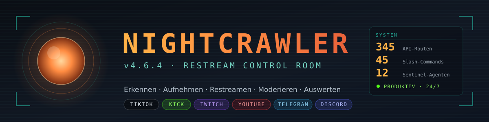
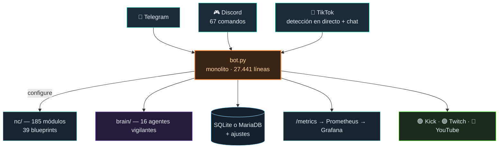

<div align="center">



### La sala de control para streaming en directo
#### Vigilancia · Grabación · Restream multidestino · Moderación con IA

🌐 **Español** · [Deutsch](README.md) · [English](README.en.md)

[](LICENSE)
[](https://www.python.org/)
[](../../actions/workflows/ci.yml)
[](../../actions/workflows/codeql.yml)
[](https://github.com/itsamemedev/Telegram-Stream-Info-Bot/releases/latest)

[](#️-manejo)
[](#️-manejo)
[](#-restream)
[](#️-base-de-datos)
[](#-monitorización)

[](https://lafap.de)
[](https://discord.gg/psvnxm7tSV)

<br>

> **Un stream de TikTok sale en directo → se detecta, se graba, se retransmite a
> Kick, Twitch y YouTube, se modera y se comenta en los tres chats — de forma
> totalmente automática, en un solo servidor, sin suscripción en la nube.**

</div>

### De un vistazo

| | |
|---|---|
| **Para qué** | Vigilancia en directo, grabación y restream multidestino de streams de TikTok, con moderación por IA en Kick, Twitch y YouTube |
| **Para quién** | Operadores que lo quieren en hardware **propio** — un servidor Linux, sin SaaS, sin plataforma ajena entre el stream y los destinos |
| **Funciona en** | Ubuntu/Debian con systemd, Python 3.12–3.14, ffmpeg, streamlink, yt-dlp — base de datos SQLite o MariaDB |
| **Manejo** | Telegram, Discord (67 comandos) y un panel web con cuatro temas en alemán, inglés y español — los ajustes, directamente en el panel |
| **Monitorización** | 16 agentes vigilantes, mapa de situación en tiempo real, Prometheus y Grafana con reglas de alerta |
| **Calidad** | más de mil contratos, CI en tres versiones de Python y contra el estado de producción congelado, `pip-audit`, CodeQL |
| **Licencia** | GPL-3.0-or-later |

---

## 📋 Contenido

- [✨ Qué hace NIGHTCRAWLER](#-qué-hace-nightcrawler) · [📦 Instalación](#-instalación) · [🔄 Actualizar y ampliar](#-actualizar-y-ampliar)
- [⚙️ Ajustes](#️-ajustes) · [🗄️ Base de datos](#️-base-de-datos) · [🕹️ Manejo](#️-manejo)
- [📡 Restream](#-restream) · [🧠 AZRAEL y los vigilantes](#-azrael-y-los-vigilantes) · [🖥️ Panel](#️-panel)
- [📈 Monitorización](#-monitorización) · [🚀 Operación](#-operación) · [🛡️ Seguridad](#️-seguridad)
- [🩺 Diagnóstico](#-diagnóstico) · [🆕 Novedades en v5.1](#-novedades-en-v51) · [Novedades en v5.0](#-novedades-en-v50) · [Novedades en v4.6](#-novedades-en-v46) · [📊 Estado del proyecto](#-estado-del-proyecto) · [💸 Apoyar](#-apoyar) · [📄 Licencia](#-licencia)

---

## ✨ Qué hace NIGHTCRAWLER

| | | |
|---|---|---|
| **🔍 Detectar** — sondeo adaptativo con histéresis anti-parpadeo; cada fila del panel dice cuándo se comprobó por última vez | **⏺️ Grabar** — grabador en tres etapas (ffmpeg → streamlink → yt-dlp) con comprobación previa, control de la pista de audio y detección de bloqueos | **📡 Retransmitir** — Kick, Twitch y YouTube a la vez, verificación de destinos contra las API de las plataformas |
| **🛡️ Moderar** — SENTINEL-SHIELD contra doxxing y odio, determinista y **antes** de cualquier IA | **🤖 Participar** — AZRAEL responde en tres chats, reacciona a la emisión y aparece en la imagen | **📊 Evaluar** — panel con 379 rutas de API, grafo de conocimiento, diario de ingresos con cadena de hashes, PWA |



---

## 📦 Instalación

```bash
git clone https://github.com/itsamemedev/Telegram-Stream-Info-Bot.git ~/nightcrawler
bash ~/nightcrawler/tools/installer.sh        # --express = menos preguntas, --unattended = ninguna
```

En Windows: `tools\install.bat`. El script explica cada paso, pregunta antes de
cada cambio, crea el venv y el `.env`, instala los paquetes del sistema, lo
comprueba con `bot.py --selfcheck` y, si se desea, configura el arranque
automático. Una segunda ejecución actualiza una instalación existente en lugar
de sobrescribirla.

**A mano:**

```bash
python3 -m venv .venv && source .venv/bin/activate
pip install -r requirements.txt
sudo apt install -y ffmpeg streamlink yt-dlp
cp .env.example .env && nano .env      # como mínimo BOT_TOKEN
python3 bot.py
```

Requisitos: Linux con systemd, **Python 3.12 como mínimo** (con 3.11 `bot.py`
no se puede analizar), 4 núcleos y 4 GB de RAM (recomendado 8 núcleos, 16 GB).

---

## 🔄 Actualizar y ampliar

**El código nuevo** se instala con la función de actualización — en el panel
(Resumen → estado del software) o con `/update` en Telegram. Trae el estado de
este repositorio archivo por archivo; después hay que reiniciar el servicio
(botón en el panel).

**Lo que falta** lo instala `tools/update.sh`:

```bash
bash tools/update.sh                 # guiado: comprueba, muestra el plan y pregunta por complementos
bash tools/update.sh --check         # solo comprobar, código de salida 1 si falta algo
bash tools/update.sh --mariadb       # mudar la base de datos de SQLite a MariaDB
```

En modo guiado pregunta por todo lo que falta: **Prometheus** (con **Grafana**),
paquetes opcionales de Python y — si la base de datos sigue en SQLite — la
mudanza a **MariaDB**. En modo desatendido y con `--check` no pregunta ni
dispara nada.

---

## ⚙️ Ajustes

**En el panel, pestaña “Ajustes”.** Las unas 600 variables de `.env.example`
con grupo, valor por defecto y descripción, con búsqueda. Cada fila indica de
dónde viene el valor — *fijado en el panel*, *desde .env* o *por defecto*. Se
guarda en la base de datos y, en el siguiente arranque, tiene prioridad sobre
`.env`:

```
panel (base de datos)   ›   .env   ›   valor por defecto del código
```

- **“Importar desde .env”** copia `.env` una vez a la base de datos.
- **“Volver a .env”** borra una entrada; vuelve a valer el archivo.
- Muchos valores solo se leen al arrancar — reinicia el servicio tras guardar.
- **Los secretos** (tokens, claves, contraseñas) solo se pueden escribir; el
  panel muestra *si* están fijados, nunca el valor.

> [!IMPORTANT]
> **Solo en `.env`** — desde el panel serían un botón de control remoto del
> servidor: la conexión a la base de datos (`DB_*`, `MARIADB_*`), el acceso al
> panel (`DASHBOARD_TOKEN`, `DASHBOARD_PIN`, `WEB_HOST`, puerto, TLS,
> `TRUSTED_PROXIES`) y todo lo que decide código, programas o rutas
> (`UPDATE_*`, `*_CMD`, `*_BIN`, `*_DIR`, `*_PATH`).

> [!WARNING]
> **`.env` nunca va al repositorio.** Contiene cookies, tokens OAuth y claves de
> stream.

---

## 🗄️ Base de datos

Desde v5.3.1 MariaDB es el valor por defecto para instalaciones **nuevas**: el
instalador configura servidor, base de datos, usuario, el controlador C y los
ajustes; si el servidor no se puede configurar, se queda en SQLite y lo dice.
SQLite (un archivo, sin servicio) sigue siendo el valor por defecto donde ya hay
datos en SQLite, sin gestor de paquetes o con menos de 1 GB de RAM. Para una
instalación SQLite existente, `bash tools/update.sh --mariadb` instala el
servidor, crea la base de datos y el usuario, detiene el bot un momento, muda
**cada tabla**, **vuelve a contar** y solo entonces fija `DB_BACKEND=mariadb`
en `.env` (antes guarda `.env.vor-mariadb-<hora>`). Un destino con datos no se
sobrescribe nunca.

> [!TIP]
> **Vuelta atrás:** el archivo SQLite queda intacto. `DB_BACKEND=sqlite` en
> `.env` y reiniciar.

El **vigilante de la base de datos** mide cada cinco minutos el tiempo de
respuesta, el tamaño, el crecimiento, el diario de SQLite (`-wal`) y si el
esquema coincide con el código.

---

## 🕹️ Manejo

### Telegram

| Comando | Efecto |
|---|---|
| `/tiktok` `‹nombre›` | Análisis del perfil de una cuenta de TikTok |
| `/live` `@usuario` | Comprobar ahora si está en directo |
| `/quelle` `‹nombre›` | Medir las fuentes del stream de un usuario en directo, con la solución |
| `/track` `‹nombre›` · `/untrack` · `/track_exact` · `/bulkadd` | Seguir usuarios de TikTok |
| `/pause` · `/resume` · `/unpause` | Pausar y reanudar el seguimiento |
| `/tracklist` · `/recstatus` · `/stoprec` | Cuentas seguidas, grabaciones en curso, detener una grabación |
| `/cleanup` · `/quota` · `/teststream` | Limpiar grabaciones antiguas, cuota de almacenamiento, autoprueba del grabador |
| `/stats` · `/topusers` · `/summary` · `/einnahmen` | Estadísticas, top de streamers, resumen diario, ingresos y donaciones |
| `/ai` · `/aireset` · `/brain` · `/report` | Preguntar a AZRAEL, reiniciar el contexto de IA, estado del cerebro, informe semanal |
| `/cookies` · `/sysres` · `/logs` · `/diag` | Cookies, recursos del sistema, últimos errores, diagnóstico completo |
| `/about` · `/help` · `/start` · `/update` | Acerca de, ayuda, inicio, instalar actualización (solo Telegram) |
| `/spenden` | Apoyar el proyecto: PayPal y direcciones cripto |

**Discord — 67 comandos:** los comunes llevan el mismo nombre que en Telegram;
además análisis (`/status`, `/streaminfo`), seguimiento (`/livenow`,
`/restream_status`, `/follow`), clips (`/clips`, `/clip`, `/clipoftheweek`),
comunidad (`/rank`, `/leaderboard`, `/daily`, `/profile`, `/event`), moderación
(`/warn`, `/purge`, `/kick`, `/ban`, `/timeout`) y administración del servidor
(`/setup_community`, `/setup_targets`, `/create_channel`, …). Lista completa en
el [README en inglés](README.en.md#️-operating-it).

---

## 📡 Restream

Kick, Twitch y YouTube a la vez mediante `tee` de ffmpeg. En cuanto hay un
destino adicional se transcodifica (fotogramas clave cada 2 s), porque las tres
plataformas exigen GOP distintos. Un destino solo cuenta como en línea cuando la
propia plataforma lo confirma: 90 s de gracia, tres fallos seguidos, “desconocido”
no es “sin conexión”. Activar: `KICK_STREAM_KEY`, `TWITCH_ENABLED` +
`TWITCH_STREAM_KEY`, `YOUTUBE_ENABLED` + `YOUTUBE_STREAM_KEY` — en el panel o en
`.env`.

---

## 🧠 AZRAEL y los vigilantes

`brain/` es un núcleo de IA independiente con base de datos propia; sin él, el
bot arranca igual. AZRAEL responde con Anthropic (con clave), en local con
ik_llama.cpp (Qwen3-14B-Uncensored, `sudo bash tools/ikllama.sh`) o mediante API gratuitas, con control de presupuesto.

| Agente | Vigila | Agente | Vigila |
|---|---|---|---|
| `health` | estado general | `restream_sentinel` | destinos de restream que fallan en silencio |
| `recovery` | grabaciones atascadas | `toxicity` | oleadas de toxicidad en el chat |
| `scout` | nuevas fuentes en directo | `uptime` | conexiones de chat |
| `analytics` | cifras y tendencias | `recording` | grabaciones cuyo archivo no crece |
| `learning` | grafo de conocimiento | `proxy` | éxito de las peticiones a TikTok, bloqueos 403 |
| `sentinel` | CrowdSec | `swap` | uso del swap |
| `disk` | espacio en disco | `datenbank` | tiempo de respuesta, crecimiento, diario, esquema |
| `prometheus` | la central de alertas: accesible, lee el bot, reglas, alertas activas — la reinicia | `grafana` | acceso, fuente de datos, panel — lo reinicia |

**SENTINEL-SHIELD** detecta doxxing, odio y amenazas de forma determinista,
antes de cualquier IA, con normalización de leetspeak, homoglifos y caracteres
invisibles — afinado para **cero falsos positivos**.

---

## 🖥️ Panel

En `127.0.0.1:8050` — desde fuera **solo** con un túnel SSH:
`ssh -L 3000:localhost:8050 ubuntu@<ip-del-servidor>` y luego
`http://localhost:3000`.

Pestañas: **Resumen** (cifras, estado del software, **mapa de situación** con
núcleo, siete estaciones, los vigilantes en su puesto y los usuarios en
directo) · Control · Streams · Comunidad · **Sistema** (recursos, túnel,
Prometheus y Grafana, registro en vivo) · AZRAEL Brain · Operación · Insights ·
**Ajustes**. Temas: Latón (oscuro) · Plano (claro) · Contraste (WCAG AAA) ·
Fósforo (noche). Instalable como **PWA** en el móvil.

---

## 📈 Monitorización

```bash
sudo bash tools/observability.sh --grafana     # o guiado: bash tools/update.sh
```

Prometheus como servicio propio solo en `127.0.0.1` lee `/metrics`; Grafana
trae un panel en el que **cada** métrica tiene su gráfico. Sin admin/admin: la
contraseña se genera y queda en `.env` como `GRAFANA_ADMIN_PASSWORD`. **16
reglas de alerta** probadas con `promtool`. El panel (Sistema → “Prometheus &
Grafana”) comprueba si Prometheus lee de verdad el bot.

---

## 🚀 Operación

```bash
sudo systemctl enable --now nightcrawler
journalctl -u nightcrawler -f
curl -s localhost:8050/healthz | python3 -m json.tool
```

La vía normal es la función de actualización (panel o `/update`) seguida de un
reinicio. Alternativa: `tools/deploy.sh <build.zip>` comprueba en un directorio
aparte y restaura la copia si algo falla. Detalles en
**[`docs/en/DEPLOY.md`](docs/en/DEPLOY.md)**.

---

## 🛡️ Seguridad

- El panel escucha solo en `127.0.0.1` (impuesto si no hay token ni PIN).
- `.env` nunca está en el repositorio ni en el archivo de entrega.
- Acceso, comandos, rutas y conexión a la base de datos solo desde `.env`.
- Cookies, claves y tokens se ocultan antes de escribir el registro.
- **No mezclar dinero:** la telemetría de donaciones son **estimaciones**; el
  diario de ingresos son **pagos** contabilizados. Los regalos de TikTok van al
  streamer seguido y no entran en ninguna suma.

¿Una vulnerabilidad? → **[`docs/en/SECURITY.md`](docs/en/SECURITY.md)**, por favor sin issue público.

---

## 🩺 Diagnóstico

```bash
curl -s localhost:8050/api/selftest | python3 -m json.tool
```

Cada hallazgo con el comando que lo soluciona. ¿En directo pero sin restream?
En Telegram, `/quelle ‹nombre›` mide cada vía hacia la dirección del stream.
Más en **[`docs/en/TROUBLESHOOTING.md`](docs/en/TROUBLESHOOTING.md)**.

---

## 🆕 Novedades en v5.5

**“Voz”** — AZRAEL habla con su persona a través del Qwen3-14B local:

- **Vinculado, no adivinado:** `AZRAEL_LLM=lokal` (por defecto si llama-server
  está instalado) — sin Claude delante ni cambio silencioso a la nube. Si Qwen
  no responde, AZRAEL calla y el registro dice por qué.
- **La persona llega a todas partes:** Telegram, Discord y `!ask` no la recibían.
  Ahora todos los caminos empiezan con la misma persona del panel.
- **Más rápido en CPU:** caché de prompt con las partes fijas delante — la
  persona se lee una vez, no en cada mensaje.
- **Prioridad:** las conversaciones esperan el turno y adelantan a las
  reacciones; la iniciativa propia se descarta si hay cola. `/healthz` muestra quién responde.

## 🆕 Novedades en v5.4

**“Llavero”** — para que la grabación y el restream lleguen a la dirección del stream:

- **Cookies desde el móvil:** exportación de Cookie-Editor en JSON, Netscape
  **o** cadena de cabecera; pégala en el panel o **elige un archivo**, o envía
  el archivo por Telegram con el texto `/cookies` (el mensaje se borra después).
  Chrome para Android no puede exportar; Firefox para Android con Cookie-Editor sí.
- **Directos +18 con su nombre:** se reconoce el código 4003110 de TikTok — el
  aviso dice que falta una cuenta con sesión iniciada y edad verificada.
- **El yt-dlp correcto:** el bot pone su venv al principio del PATH, avisa de la
  antigüedad y de curl_cffi ausente, y `update.sh` mantiene yt-dlp y streamlink al día.

## 🆕 Novedades en v5.1

**“Oído fino”** — LLM local y los hallazgos del registro de producción del 11/11:
ik_llama.cpp con Qwen3-14B-Uncensored en lugar de llama.cpp (`tools/ikllama.sh`
desinstala primero un llama.cpp existente; instalador y `update.sh --ik-llama`
usan la misma herramienta; probar antes `bash tools/ikllama.sh --dry-run`),
Qwen3 sin modo de pensamiento, la cola de comprobaciones en directo ya no se
atasca, el cambio de modelo de Whisper comprueba la memoria (el salto a 4,5 GB
venía de `medium`, no de una fuga), y la vista de situación muestra colas de
codificación y subida, grabación a Discord, navegador del overlay, túnel, chat
de Kick y meta de donaciones.

## 🆕 Novedades en v5.0

**“Compás”** — una caza profunda de errores en todas las áreas, 60 hallazgos
corregidos, cada uno con contrato y prueba de mutación: restream estable (el
vigilante ya no mata al emisor sano bajo carga de disco), suavizado de marcas
de tiempo en grabación y restream, cola de codificación, un tema de Telegram
por usuario, la grabación completa en partes a Discord, AZRAEL con contexto del
cerebro, chat de Kick por Centrifugo, `/spenden`, una sola meta de donaciones y
protección CSRF en el panel.

## 🆕 Novedades en v4.6

**“Centro de control”** — todo configurable, todo vigilado: ajustes en el panel
guardados en la base de datos, mudanza de SQLite a MariaDB en un paso con
recuento, Prometheus y Grafana completos con 16 reglas de alerta, el 14.º
vigilante para la base de datos, un mapa de situación redibujado y `update.sh`
que pregunta por lo que falta. **Parche 4.6.1:** detrás del nginx del
instalador el panel estaba abierto sin inicio de sesión; once fallos corregidos. **Parche 4.6.2:** la mudanza a MariaDB lleva el diario fiscal y el archivo. **Parche 4.6.3:** MariaDB compara byte a byte como SQLite. **Parche 4.6.4:** cookies seguras tras el proxy HTTPS. **Parche 4.6.5:** los directos de suscriptores/18+ se reconocen, un restream oscuro se notifica y Kick busca su clúster Pusher. **Parche 4.6.6:** un restream cuya fuente envía datos sin imagen conmutable ya no se queda en silencio en la pantalla de pausa. **Parche 4.6.7:** el mapa de situación es una pantalla de radar con barrido, persistencia, módulos de cristal y paquetes de datos. **Parche 4.6.8:** Kick solo prueba clústeres Pusher reales, el estado del restream ya no bloquea el bucle y sin avalancha de registros del resolvedor. **Parche 4.6.9:** el chat de TikTok aparece ahora también en las grabaciones (incrustado o como pista de subtítulos, `AUFNAHME_CHAT`). **Parche 4.6.10:** un restream sin imagen de origen cambia a un destino con imagen, el director de hype monta los memes y los clips llevan el chat. **Parche 4.6.11:** en modo HTML vuelven a llegar la imagen y el sonido de la fuente. **Parche 4.6.12:** caza profunda de errores — la búsqueda de clúster de Kick tras un cambio de clave, una sala cerrada termina con el directo, el chat de la grabación termina con ella, sin chat doble en los clips y las categorías 🎯 ajenas en Discord no se tocan. **Parche 4.6.13:** el montaje de memes respeta la ventana de subida y el diario fiscal comprueba tipo de cambio e importe original. **Parche 4.6.14:** el chat de una grabación guardada al detener se incorpora al archivo en el siguiente arranque en lugar de quedar al lado como `.ass`. **Parche 4.6.15:** los `.ass` antiguos se recogen e incorporan al arrancar; las donaciones registradas en el panel cuentan para la meta del overlay. **Parche 4.6.16:** «sin URL de origen reproducible» indica en el panel también por qué no funcionó el paso directo. **Parche 4.6.17:** subidas a Telegram para seguimientos de Discord, la subida ya no espera al chat, el paso directo prueba streamlink y Kick prueba claves conocidas. **Parche 4.6.18:** un solo tema de subidas en Telegram en lugar de temas @nombre (los antiguos se vuelven a subir y luego se borran), un solo canal de clips en Discord en lugar de áreas 🎯, y los seguimientos del panel van a Telegram. **Parche 4.6.19:** al publicar un enlace de YouTube o TikTok en Telegram o Discord, el bot responde con el vídeo. **Parche 4.6.20:** el overlay HTML mantiene abierto un Chromium por restream en lugar de arrancar uno nuevo por imagen: unas once veces menos CPU. **Parche 4.6.21:** el chat de Kick vuelve a funcionar: Kick pasó de Pusher a Centrifugo y el bot lo sigue. **Parche 4.6.22:** `/spenden` en Telegram y Discord: PayPal, direcciones cripto y meta de donaciones. **Parche 4.6.23:** una sola meta de donaciones para la web, el overlay, la imagen del stream y `/spenden`.
Todas las oleadas en
**[`docs/CHANGELOG.md`](docs/CHANGELOG.md)**.

---

## 📊 Estado del proyecto

| | |
|---|---|
| Versión actual | **5.5.0** — “Voz” (2026.11) |
| Rutas Flask | 379 (34 en `bot.py` · 345 en `nc/routes/`) |
| Comandos de Discord | 67 |
| Agentes vigilantes | 14 |
| Variables de configuración | ~577 |
| Idiomas | alemán (origen), inglés, español |

---

## 💸 Apoyar

NIGHTCRAWLER y Azrael Sentinel se alojan por cuenta propia, sin publicidad y
sin patrocinador. El servidor, el túnel VPS, el almacenamiento y el cálculo de
la IA cuestan dinero real cada mes.

| Vía | Dirección |
|---|---|
| **PayPal** | [`paypal@voice4you.org`](https://www.paypal.com/donate/?business=paypal%40voice4you.org&currency_code=EUR&item_name=Azrael%20Sentinel%20-%20Betrieb) |

Las direcciones cripto y la meta de donaciones están en la web; en el chat el
bot lo muestra todo con **`/spenden`** (Telegram y Discord).

---

## 📄 Licencia

**GNU General Public License v3.0 o posterior** — texto completo en
**[`LICENSE`](LICENSE)**. Contribuciones: **[`docs/en/CONTRIBUTING.md`](docs/en/CONTRIBUTING.md)** ·
comunidad en **[Discord](https://discord.gg/psvnxm7tSV)** · **[lafap.de](https://lafap.de)**.

<div align="center">

**NIGHTCRAWLER v5.0.0 · “Compás”**

</div>
