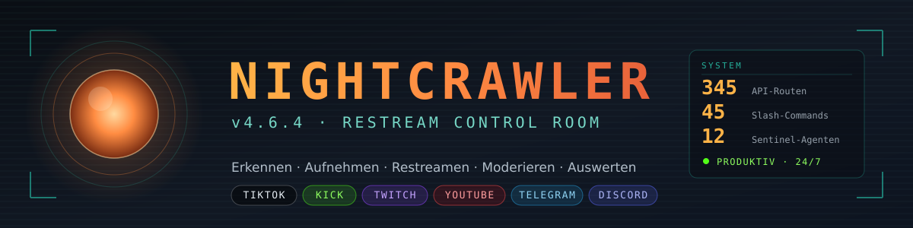
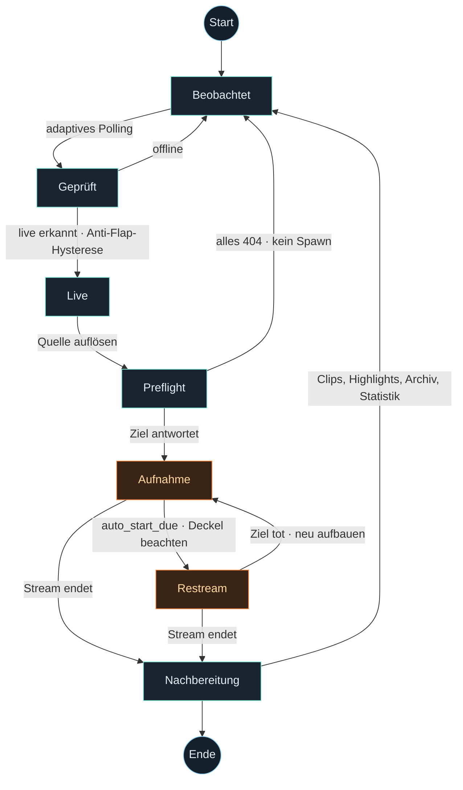
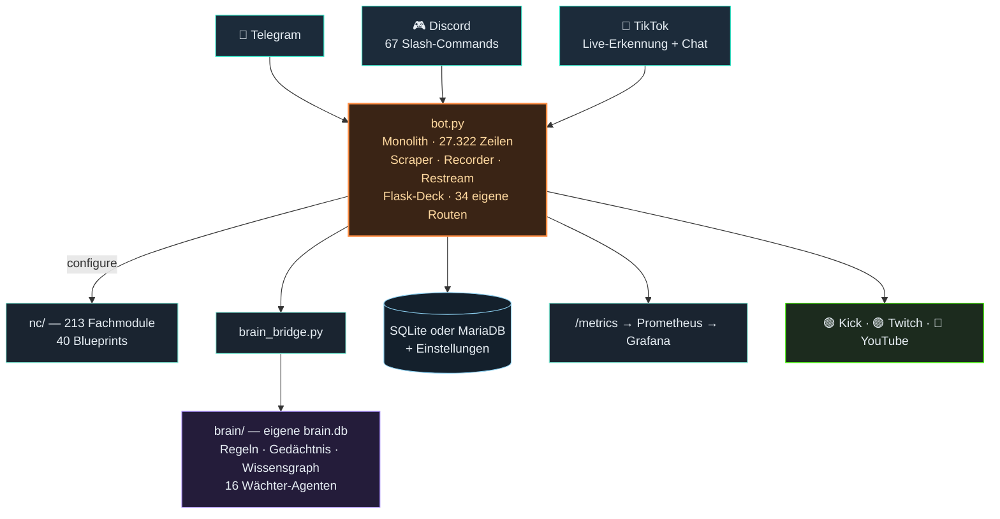
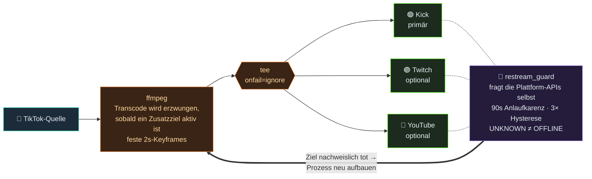

<div align="center">



### Der Kontrollraum für Live-Streaming
#### Überwachung · Aufnahme · Multi-Ziel-Restream · KI-Moderation

🌐 **Deutsch** · [English](README.en.md) · [Español](README.es.md)

[](LICENSE)
[](https://www.python.org/)
[](../../actions/workflows/ci.yml)
[](../../actions/workflows/codeql.yml)
[](https://github.com/itsamemedev/Telegram-Stream-Info-Bot/releases/latest)

[](#️-bedienung)
[](#️-bedienung)
[](#-restream)
[](#️-datenbank)
[](#-beobachtung)
[](#️-dashboard)

[](https://lafap.de)
[](https://discord.gg/psvnxm7tSV)

<br>

> **Ein TikTok-Stream geht live → wird erkannt, mitgeschnitten, nach Kick, Twitch
> und YouTube weitergesendet, in allen drei Chats moderiert und kommentiert —
> vollautomatisch, auf einem einzigen Server, ohne Cloud-Abo.**

</div>

### Auf einen Blick

| | |
|---|---|
| **Wofür** | Live-Überwachung, Aufnahme und Multi-Ziel-Restream von TikTok-Streams, mit KI-Moderation in Kick, Twitch und YouTube |
| **Für wen** | Betreiber, die das auf **eigener** Hardware wollen — ein Linux-Server, kein SaaS, keine Fremdplattform zwischen Stream und Zielen |
| **Läuft auf** | Ubuntu/Debian mit systemd, Python 3.12–3.14, ffmpeg, streamlink, yt-dlp — Datenbank SQLite oder MariaDB |
| **Bedienung** | Telegram, Discord (67 Slash-Commands) und ein Web-Deck mit vier Themen auf Deutsch, Englisch und Spanisch — Einstellungen direkt im Deck |
| **Beobachtung** | 16 Wächter-Agenten, Lagebild in Echtzeit, Prometheus und Grafana mit Alarmregeln |
| **Qualität** | über tausend Verträge, CI auf drei Python-Fassungen und gegen den eingefrorenen Produktionsstand, `pip-audit`, CodeQL |
| **Lizenz** | GPL-3.0-or-later |

---

## 📋 Inhalt

- [✨ Was NIGHTCRAWLER macht](#-was-nightcrawler-macht) · [🏗️ Architektur](#️-architektur)
- [📦 Installation](#-installation) · [🔄 Aktualisieren und erweitern](#-aktualisieren-und-erweitern)
- [⚙️ Einstellungen](#️-einstellungen) · [🗄️ Datenbank](#️-datenbank)
- [🕹️ Bedienung](#️-bedienung) · [📡 Restream](#-restream) · [🧠 AZRAEL und die Wächter](#-azrael-und-die-wächter)
- [🖥️ Dashboard](#️-dashboard) · [📈 Beobachtung](#-beobachtung) · [🚀 Betrieb](#-betrieb)
- [🛡️ Sicherheit](#️-sicherheit) · [🩺 Fehlersuche](#-fehlersuche) · [🧪 Entwicklung](#-entwicklung)
- [🆕 Neu in v5.3](#-neu-in-v53) · [Neu in v5.2](#neu-in-v52) · [Neu in v5.1](#-neu-in-v51) · [Neu in v5.0](#-neu-in-v50) · [Neu in v4.6](#-neu-in-v46) · [📊 Projektstatus](#-projektstatus) · [💸 Unterstützen](#-unterstützen) · [🤝 Mitwirken](#-mitwirken) · [📄 Lizenz](#-lizenz)

---

## ✨ Was NIGHTCRAWLER macht

| | | |
|---|---|---|
| **🔍 Erkennen** — adaptives Polling mit Anti-Flap-Hysterese; jede Zeile im Deck sagt, wann sie zuletzt geprüft wurde | **⏺️ Aufnehmen** — dreistufiger Recorder (ffmpeg → streamlink → yt-dlp) mit Preflight, Tonspur-Prüfung und Hänger-Erkennung | **📡 Weitersenden** — Kick, Twitch und YouTube gleichzeitig, Ziel-Verifikation gegen die Plattform-APIs |
| **🛡️ Moderieren** — SENTINEL-SHIELD gegen Doxxing und Hass, deterministisch und **vor** jeder KI | **🤖 Mitreden** — AZRAEL antwortet in drei Chats, reagiert aufs Sendebild und steht als Figur im Bild | **📊 Auswerten** — Deck mit 386 API-Routen, Wissensgraph, Einnahmen-Journal mit Hash-Kette, PWA |

<details>
<summary><b>🔎 Vollständige Funktionsliste</b></summary>

<br>

| Bereich | Funktion |
|---|---|
| **Live-Erkennung** | Adaptives Polling · Anti-Flap-Hysterese · Abo-Stream-Erkennung · Proxy-/SOCKS-Support · Cookie-Rotation |
| **Aufnahme** | Dreistufiger Recorder-Fallback · Preflight-GET vor Spawn · Suffix-Fallback für CDN-Quirks · Recording-Wächter gegen eingefrorene Mitschnitte · S3-Backup (optional) |
| **Restream** | Kick / Twitch / YouTube parallel · `tee` mit `onfail=ignore` · erzwungener Transcode bei Multi-Ziel · Ziel-Verifikation über Plattform-APIs · Wiederanlauf nach Neustart · sicherer Test-Push ohne Broadcast-Risiko · Deckel für gleichzeitige Restreams |
| **Chat & Moderation** | SENTINEL-SHIELD (Doxxing / Hate / Drohung) · geteilte Moderations-Heuristik über Kick, Twitch, YouTube · Fremdwerbungs-Erkennung mit Eigen-Allowlist · Banned-Words · Timeout-Eskalation |
| **KI (AZRAEL)** | Chat-Antworten auf Ansprache · Live-Reaktionen aufs Sendebild · Sprachausgabe (Piper) · Persona-System · Multi-Backend: Anthropic (mit Key) → lokales ik_llama.cpp mit Qwen3-14B-Uncensored (bevorzugt, sobald es läuft) → freie APIs · Budget- und Tier-Steuerung |
| **Gehirn (`brain/`)** | Zustandsmaschine · regelbasierte Tier-1-Entscheidungen mit Warum-Log · Langzeitgedächtnis · Wissensgraph (Triple-Store) · semantische Suche · Prognosen · Wochenreport |
| **Sentinel-Flotte** | 16 Wächter-Agenten (health, recovery, scout, analytics, learning, sentinel, disk, swap, restream, toxicity, uptime, recording, proxy, datenbank, prometheus, grafana) mit Telegram-Alarm, einzeln abschaltbar |
| **Community** | Wiedererkennung von Stammzuschauern · Loyalty-Punkte & Ränge · Discord-XP, Level, Daily-Streak · Live-Ping · Highlight-Share · Community-Events |
| **Geld** | Spenden-Telemetrie (Schätzwerte) · getrenntes Einnahmen-Journal (`nc/ledger.py`) mit Hash-Kette und CSV-Export fürs Finanzamt |
| **Dashboard** | 386 Flask-Routen · Live-Panels · Gehirn-Visualisierung mit Lernkurve · Overlay für OBS · installierbare PWA (Android) · QR-Login |
| **Betrieb** | systemd-Dienst · Deploy-Skript mit Vorabprüfung und Auto-Rollback · Selbsttest-Route · Totmann-Meldung bei Prozesstod · CrowdSec-Anbindung · Log-Redaction für Cookies und Stream-Keys |
| **Datenbank** | SQLite **oder** MariaDB · Umzug per `update.sh --mariadb` mit Nachzählen · zentrales Schema-Modul · Export-Werkzeug · Datenbank-Wächter |
| **Einstellungen** | Reiter „Einstellungen“ im Deck: alle ~620 Variablen durchsuchbar, gespeichert in der Datenbank, geschützte Schlüssel nur aus der `.env` |
| **Beobachtung** | `/metrics` für Prometheus · Grafana-Dashboard mit jedem Messwert · 16 Alarmregeln mit Tests · Einrichtung per `tools/observability.sh` |

</details>

### Der Lebenszyklus eines Streams



---

## 🏗️ Architektur



> [!IMPORTANT]
> `nc/*`, `brain/*` und `discordbot.py` importieren **nie** aus `bot.py`.
> Konfiguration kommt per `configure(...)`-Injection — das hält die Bibliotheken
> isoliert testbar und verhindert Zirkularimporte.

---

## 📦 Installation

### Geführt — ein Befehl

```bash
git clone https://github.com/itsamemedev/Telegram-Stream-Info-Bot.git ~/nightcrawler
bash ~/nightcrawler/tools/installer.sh        # --express = weniger Fragen, --unattended = keine
```

Unter Windows: `tools\install.bat`. Das Skript erklärt jeden Schritt, fragt vor
jedem Eingriff, legt venv und `.env` an, installiert die Systempakete, prüft mit
`bot.py --selfcheck` nach und richtet auf Wunsch den Autostart ein (systemd mit
Totmann-Meldung, launchd, Aufgabenplanung). Ein zweiter Lauf gleicht eine
bestehende Installation an, statt sie zu überschreiben.

### Von Hand

```bash
git clone https://github.com/itsamemedev/Telegram-Stream-Info-Bot.git && cd Telegram-Stream-Info-Bot
python3 -m venv .venv && source .venv/bin/activate
pip install -r requirements.txt
sudo apt install -y ffmpeg streamlink yt-dlp
cp .env.example .env && nano .env      # mindestens BOT_TOKEN
python3 bot.py
```

Schritt für Schritt, mit OAuth und lokalem LLM: **[`docs/INSTALL.md`](docs/INSTALL.md)**.

| | Mindestens | Empfohlen |
|---|---|---|
| **System** | Linux mit systemd | Ubuntu 22.04 / 24.04 LTS |
| **Python** | 3.12 (PEP 701 — unter 3.11 parst `bot.py` nicht) | 3.13 / 3.14 |
| **CPU · RAM** | 4 Kerne · 4 GB | 8 Kerne · 16 GB (Transcode, lokales LLM) |
| **Platte · Upload** | 20 GB · 10 Mbit | 200 GB+ · 50 Mbit+ |

---

## 🔄 Aktualisieren und erweitern

**Code einspielen** geht über die Update-Funktion — im Deck (Übersicht →
Software-Stand) oder per Telegram `/update`. Sie holt den Stand aus diesem
Repository und spielt ihn Datei für Datei ein; danach den Dienst neu starten
(Knopf im Deck). Bis dahin meldet `/healthz` den Stand als `veraltet`.

**Fehlendes nachinstallieren** macht `tools/update.sh`:

```bash
bash tools/update.sh                 # geführt: prüft, zeigt den Plan, fragt nach Zusatzfunktionen
bash tools/update.sh --check         # nur prüfen, Exitcode 1, wenn etwas fehlt
bash tools/update.sh --dry-run       # zeigen, was liefe
bash tools/update.sh --mariadb       # Datenbank von SQLite nach MariaDB umziehen
```

Im geführten Modus fragt es nach allem, was noch fehlt: **Prometheus** (samt
**Grafana**), optionale Python-Pakete und — liegt die Datenbank noch in SQLite —
den Umzug nach **MariaDB**. Unbeaufsichtigt und mit `--check` fragt es nichts und
löst nichts aus; ein Zeitplan zieht nie still eine Datenbank um.

---

## ⚙️ Einstellungen

**Im Deck, Reiter „Einstellungen“.** Alle rund 620 Variablen aus `.env.example`
mit Gruppe, Vorgabe und Beschreibung, durchsuchbar. Je Zeile steht, woher der
Wert kommt — *vom Deck gesetzt*, *aus der .env* oder *Vorgabe*. Gespeichert wird
in der Datenbank (SQLite oder MariaDB); die Werte gelten beim nächsten Start
**vor** der `.env`:

```
Deck (Datenbank)   ›   .env   ›   Vorgabe im Code
```

- **„Aus der .env übernehmen“** kopiert die `.env` einmal in die Datenbank —
  ein Knopf, kein Automat: liefe es still beim Start, wirkte danach keine
  Änderung an der `.env` mehr.
- **„Zur .env zurück“** löscht einen Eintrag; es gilt wieder die Datei.
- Viele Werte liest der Bot nur beim Start — nach dem Speichern den Dienst neu
  starten (Knopf im Reiter).
- **Geheimnisse** (Tokens, Schlüssel, Passwörter) sind nur schreibbar; das Deck
  zeigt, *ob* sie gesetzt sind, nie welcher Wert.

> [!IMPORTANT]
> **Nur in der `.env`** — aus dem Deck wären sie ein Fernsteuer-Knopf auf den
> Server: die Datenbank-Verbindung (`DB_*`, `MARIADB_*`), der Deck-Zugang
> (`DASHBOARD_TOKEN`, `DASHBOARD_PIN`, `WEB_HOST`, Port, TLS, `TRUSTED_PROXIES`)
> und alles, was Code, Programme oder Pfade bestimmt (`UPDATE_*`, `*_CMD`,
> `*_BIN`, `*_DIR`, `*_PATH`). Ein solcher Eintrag in der Datenbank wird beim
> Start ignoriert und gemeldet.

**Das Minimum in der `.env`:**

```ini
BOT_TOKEN=123456:ABC-DEF…            # Telegram-Bot von @BotFather
ADMIN_CHAT_ID=123456789              # deine Telegram-ID (Alarme, Admin-Befehle)
```

OAuth: **[Twitch](docs/SETUP_TWITCH_OAUTH.md)** · **[YouTube](docs/SETUP_YT_OAUTH.md)** · Kick direkt im Deck.

> [!WARNING]
> **`.env` gehört nie ins Repository.** Sie enthält Cookies, OAuth-Tokens und
> Stream-Keys; ein einmal committetes Geheimnis steht für immer in der Historie.

---

## 🗄️ Datenbank

| | MariaDB (Vorgabe seit v5.3.1) | SQLite |
|---|---|---|
| **Wofür** | eigener Server, mit dem C-Treiber am wenigsten CPU je Abfrage, eigene Sicherung | eine Datei, kein Dienst — wo schon Daten in SQLite liegen, ohne Paketmanager oder unter 1 GB RAM |
| **Einrichten** | neue Installation: der Installer; bestehende: `bash tools/update.sh --mariadb` | nichts |

Der Installer richtet bei einer **neuen** Installation MariaDB ein — Server,
Datenbank, Nutzer, C-Treiber und Einstellungen. Lässt sich der Server nicht
einrichten, bleibt die Installation bei SQLite und sagt es. Eine **bestehende**
SQLite-Installation wird nie still umgestellt: `update.sh` empfiehlt den Umzug
und macht ihn nur auf Nachfrage oder mit `--mariadb`.

**Der Umzug** (`--mariadb`, `tools/zu_mariadb.py`) installiert den Server, legt
Datenbank und Nutzer an (Passwort nie in einer Befehlszeile), stoppt den Bot
kurz, zieht **jede Tabelle** um, **zählt nach** und stellt erst dann
`DB_BACKEND=mariadb` in die `.env` — vorher entsteht `.env.vor-mariadb-<zeit>`.
Ein nicht leeres Ziel wird nicht überschrieben, der Bot startet danach in jedem
Fall wieder. Vorher prüfen: `venv/bin/python tools/zu_mariadb.py --dry-run`.

> [!TIP]
> **Rückweg:** die SQLite-Datei bleibt unverändert liegen. `DB_BACKEND=sqlite` in
> der `.env` und neu starten — fertig.

Der **Datenbank-Wächter** misst alle fünf Minuten Antwortzeit, Größe, Zuwachs,
bei SQLite das Journal (`-wal`) und ob das Schema zum Code passt.

---

## 🕹️ Bedienung

### Telegram

Seit v4.2-W109 stehen alle Befehle in **einem** Verzeichnis
([`nc/befehle.py`](nc/befehle.py)) — Telegram und Discord registrieren daraus,
und `/help` baut auf beiden Plattformen die Liste daraus. Die 31 gemeinsamen
Befehle heißen **auf beiden Plattformen gleich**; die früheren
`sys_`-Namen auf Discord gibt es nicht mehr.

| Befehl | Wirkung |
|---|---|
| `/tiktok` `‹name›` | Profil-Analyse eines TikTok-Accounts |
| `/live` `@user` | Live-Status sofort pruefen |
| `/quelle` `‹name›` | Stream-Quellen eines Live-Nutzers messen — jeder Weg, ffprobe, mit Abhilfe |
| `/track_exact` `‹name›` | Exakten Usernamen tracken (ohne Korrektur) |
| `/pause` `@user` | Tracking pausieren |
| `/resume` `@user` | Tracking fortsetzen |
| `/unpause` `@user` | Auto-pausierte Quelle wieder aktivieren |
| `/bulkadd` `a b c` | Mehrere User auf einmal tracken |
| `/stoprec` `@user` | Laufende Aufnahme sauber beenden |
| `/cleanup` | Alte Aufnahmen aufraeumen |
| `/quota` | Speicher-Quota |
| `/teststream` `@user` | Recorder-Selbsttest |
| `/topusers` | Top-Streamer nach Aufnahmen |
| `/summary` | Tageszusammenfassung |
| `/aireset` | KI-Kontext zuruecksetzen |
| `/brain` | Brain-Lage: Regeln, Agenten, Empfehlungen |
| `/report` | Azrael-Sentinel-Wochenreport |
| `/cookies` `[holen]` | Cookie-Status — mit 'holen' selbst beziehen |
| `/sysres` | System-Ressourcen |
| `/logs` | Letzte Fehler aus dem Log |
| `/diag` | Vollstaendige Diagnose |
| `/einnahmen` | Einnahmen und Spenden |
| `/about` | Ueber diesen Bot |
| `/tracklist` | Getrackte Accounts anzeigen |
| `/track` `‹name›` | TikTok-User tracken |
| `/untrack` `‹name›` | TikTok-User nicht mehr tracken |
| `/recstatus` | Laufende Aufnahmen |
| `/stats` | Statistik |
| `/ai` `‹frage›` | AZRAEL fragen |
| `/help` | Alle Befehle anzeigen |
| `/spenden` | Projekt unterstützen: PayPal und Krypto-Adressen |
| `/start` | Einstieg und Kurzuebersicht (nur Telegram) |
| `/update` | Update vom Repo einspielen (nur Telegram) |

<details>
<summary><h3>Discord — 67 Slash-Commands</h3></summary>

<br>

**Gemeinsam mit Telegram** *(gleicher Name, gleiche Wirkung)*
`/tiktok` · `/live` · `/quelle` · `/track_exact` · `/pause` · `/resume` · `/unpause` · `/bulkadd` · `/stoprec` · `/cleanup` · `/quota` · `/teststream` · `/topusers` · `/summary` · `/aireset` · `/brain` · `/report` · `/cookies` · `/sysres` · `/logs` · `/diag` · `/einnahmen` · `/about` · `/tracklist` · `/track` · `/untrack` · `/recstatus` · `/stats` · `/ai` · `/help` · `/spenden`

**Analyse**
`/status` · `/streaminfo`

**Tracking**
`/livenow` · `/restream_status` · `/follow` · `/unfollow`

**Aufnahmen**
`/topstreamers` · `/clips` · `/clip` · `/clipoftheweek`

**KI**
`/ask`

**System** *(Admin-Rolle nötig)*
`/botstats` · `/post_test`

**Community**
`/rank` · `/leaderboard` · `/daily` · `/profile` · `/event` · `/events`

**Moderation**
`/warn` · `/warnings` · `/clearwarns` · `/purge` · `/kick` · `/ban` · `/timeout`

**Server** *(Admin-Rolle nötig)*
`/setup_community` · `/setup_targets` · `/create_channel` · `/create_voice` · `/create_category` · `/create_role` · `/create_group` · `/assign_role` · `/remove_role` · `/set_channel_perms`

> Die Betreiberbefehle unter den gemeinsamen laufen auf Discord über den
> **Original-Telegram-Handler** (ein Update/Context-Shim) — eine Logik, kein
> Duplikat; ein Fix am Telegram-Handler wirkt auf Discord mit. Auf Discord
> brauchen sie die Admin-Rolle, auf Telegram die Freischaltung.
> `/track`, `/tracklist`, `/recstatus`, `/stats`, `/ai` und `/help` haben auf
> Discord eine eigene, für die Community offene Umsetzung; `/untrack` dürfen
> dort nur Admins oder wer das Tracking angelegt hat.
>
> Nur auf Telegram: *start* (Einstieg) und *update* — ein Update spielt Code
> auf den Server und gehört an die kleinste Tür, die Telegram-Freischaltliste,
> nicht an eine Discord-Rolle.

</details>

---

## 📡 Restream



Ziele scharf schalten — im Deck unter Einstellungen oder in der `.env`:
`KICK_STREAM_KEY`, `TWITCH_ENABLED` + `TWITCH_STREAM_KEY`, `YOUTUBE_ENABLED` +
`YOUTUBE_STREAM_KEY`, Deckel `RESTREAM_MAX_CONCURRENT`. Sobald ein Zusatzziel
aktiv ist, wird transkodiert (feste 2-s-Keyframes) — die drei Plattformen
verlangen verschiedene GOPs. Ein Ziel gilt erst als online, wenn die Plattform
es selbst bestätigt: Anlaufkarenz 90 s, drei Fehlanzeigen in Folge,
„unbekannt“ ist nicht „offline“.

Im Sendebild steht auf Wunsch **AZRAEL als Figur** (`RESTREAM_OVERLAY=1`) —
der Mund geht genau dann, wenn er im Chat oder auf den Stream antwortet.

---

## 🧠 AZRAEL und die Wächter

`brain/` ist ein eigenständiger KI-Kern mit eigener Datenbank. Fehlt er, startet
der Bot wie ohne — jeder Baustein ist additiv und einzeln abschaltbar.
AZRAEL antwortet mit Anthropic (mit Key), lokal mit ik_llama.cpp (Qwen3-14B-Uncensored, `sudo bash tools/ikllama.sh`), sobald es läuft,
sonst über freie APIs — mit Budget und Tier-Steuerung.

### 🛰️ Die 16 Wächter

| Agent | Wacht über | Agent | Wacht über |
|---|---|---|---|
| `health` | Gesamtzustand | `restream_sentinel` | still scheiternde Restream-Ziele |
| `recovery` | festgefahrene Aufnahmen, Selbstheilung | `toxicity` | Toxizitäts-Wellen im Chat (Raid) |
| `scout` | neue Live-Quellen | `uptime` | Chat-Verbindungen, Reconnect-Flattern |
| `analytics` | Kennzahlen und Trends | `recording` | Aufnahmen, deren Datei nicht wächst |
| `learning` | Lernfortschritt des Wissensgraphen | `proxy` | TikTok-Fetch-Erfolg, 403-Blocks |
| `sentinel` | CrowdSec, blinde Abwehr | `swap` | Swap-Belegung, mit OOM-Schutz |
| `disk` | Plattenplatz, Stunden bis voll | `datenbank` | Antwortzeit, Zuwachs, Journal, Schema |
| `prometheus` | Alarmzentrale selbst: erreichbar, liest den Bot, Regeln, feuernde Alarme — startet neu | `grafana` | Anmeldung, Datenquelle, Dashboard — startet neu |

Die beiden letzten laufen nur, wenn Prometheus bzw. Grafana eingerichtet ist
(`PROMETHEUS_URL` / `GRAFANA_URL`). Neu starten dürfen sie über die
sudo-Regel, die `sudo bash tools/observability.sh` anlegt — genau drei feste
Befehle, sonst nichts. Abschalten der Selbstheilung: `BRAIN_ACT_PROMETHEUS=0`
bzw. `BRAIN_ACT_GRAFANA=0`.

Jeder Agent läuft isoliert — ein toter kann den Takt nie anhalten. Abschalten:
`BRAIN_AGENT_<NAME>=0`.

### 🛡️ SENTINEL-SHIELD

Deterministische Erkennung **vor** Banned-Words und **vor** jeder KI:

- **Anti-Doxxing** — Telefonnummern, IBAN, Wohnadressen, Koordinaten, E-Mail, Klarnamen-Ansagen
- **Anti-Hate/Drohung** — Volksverhetzung inkl. Code-Zahlen (mit Kaufkontext-Guard), Suizid-Aufforderung, Gewaltandrohung
- **Tarnungs-Normalisierung** — Leetspeak, Unicode-Homoglyphen (`ѕіеg` → `sieg`), Zero-Width-Zeichen, Diakritika (NFKD), Trennzeichen (`h-e-i-l`)

> [!NOTE]
> Der Shield ist bewusst auf **null False Positives** getrimmt: `Sieglinde`,
> `1488 euro`, `heiliger`, `e-mail` und echtes Kyrillisch bleiben unangetastet.
> Bei Moderation ist ein zu Unrecht bestrafter Zuschauer schlimmer als ein
> durchgerutschter Troll. Abschalten: `SENTINEL_SHIELD=0`.

---

## 🖥️ Dashboard

Das Deck läuft auf `127.0.0.1:8050` — von außen **nur** per SSH-Tunnel:

```bash
ssh -L 3000:localhost:8050 ubuntu@<server-ip>      # dann http://localhost:3000
```

| Reiter | Inhalt |
|---|---|
| **Übersicht** | Kennzahlen, Software-Stand mit Update, **Lagebild**: Kern, sieben Stationen, die Wächter an ihrem Arbeitsplatz mit Fortschritt bis zum nächsten Lauf, die Live-Nutzer mit Aufnahme- und Restream-Zustand |
| **Control · Streams** | Restream-Kontrollraum, Ziele, Live-Wand, Transkript |
| **Community** | Discord, Loyalty, Events |
| **System** | Ressourcen, Tunnel, **Prometheus & Grafana**, Live-Log, Fehler |
| **AZRAEL Brain · Betrieb · Insights** | Gehirn, Zielprüfung, Auswertungen |
| **Einstellungen** | alle Variablen, im Deck gesetzt und in der Datenbank gespeichert |

**Themen:** Messing (dunkel, Vorgabe) · Blaupause (hell) · Kontrast (WCAG AAA,
automatisch bei „mehr Kontrast“) · Phosphor (Nacht). **Sprachen:** Deutsch,
Englisch, Spanisch — nach Browser oder per Auswahl. Als **PWA** aufs Handy:
Chrome → „Zum Startbildschirm hinzufügen“ (braucht HTTPS).

Weitere Seiten: `/brain` (Wissensgraph, Flotte), `/overlay` (Browser-Quelle für
OBS), `/api/selftest` („was ist gerade kaputt?“ — mit dem Befehl, der es behebt).

---

## 📈 Beobachtung

```bash
sudo bash tools/observability.sh --grafana     # oder geführt: bash tools/update.sh
```

- **Prometheus** als eigener Dienst, nur auf `127.0.0.1`, liest `/metrics`:
  Event-Loop, Gegendruck, Aufnahmen, Restreams, Prüfstand der Trackings, Quellen
  der Stream-Adressen, Tunnel- und Update-Lage, Schema, Log-Schleuse.
- **Grafana** mit fertigem Dashboard — **jeder** Messwert hat ein Panel, jedes
  Panel sagt, ab wann es ein Befund ist. Kein admin/admin: das Passwort wird
  erzeugt und steht in der `.env` unter `GRAFANA_ADMIN_PASSWORD`. Zugang per
  Tunnel: `ssh -L 3001:127.0.0.1:3000 <server>`.
- **16 Alarmregeln** mit `promtool`-Tests: Bot weg, Neustart-Schleife,
  Datenbank, Platte, Event-Loop, Deskriptoren, überfällige Trackings, Live ohne
  Stream-Adresse, Tunnel, Update ohne Neustart, Schema neuer als der Code, …
- In die `.env` kommen `PROMETHEUS_URL` und `GRAFANA_*`; das Deck (System →
  „Prometheus & Grafana“) fragt damit nach, ob Prometheus den Bot wirklich liest.

---

## 🚀 Betrieb

```bash
sudo systemctl enable --now nightcrawler
journalctl -u nightcrawler -f
curl -s localhost:8050/healthz | python3 -m json.tool
```

| Weg | Wann |
|---|---|
| **Update-Funktion** (Deck, `/update`) | der normale Weg — holt den Stand aus GitHub, danach neu starten |
| **`tools/deploy.sh <build.zip>`** | Archiv aus `tools/build_release.py`; prüft im Nebenverzeichnis, schwenkt erst bei Grün um und spielt bei Fehlern das Backup zurück |
| **Totmann-Meldung** | `OnFailure=nightcrawler-notify@%n.service` — stirbt der Prozess, kommt eine Nachricht mit den letzten Logzeilen |

Ausführlich: **[`docs/DEPLOY.md`](docs/DEPLOY.md)** · **[`docs/START_HIER.txt`](docs/START_HIER.txt)**.

---

## 🛡️ Sicherheit

| Regel | Warum |
|---|---|
| **Deck nur auf `127.0.0.1`** | ohne Token und PIN erzwungen; Zugang per SSH-Tunnel |
| **`.env` nie im Repo, nie im Archiv** | Cookies, OAuth-Tokens, Stream-Keys |
| **Geschützte Einstellungen** | Zugang, Befehle, Pfade und Datenbank-Verbindung nur aus der `.env` |
| **Redaction beim Logging** | Cookies, Keys und Tokens werden vor dem Loggen geschwärzt |
| **Ledger mit Hash-Kette** | append-only; Korrektur ist eine Gegenbuchung |

> [!WARNING]
> **Geld nicht vermischen.** Spenden-Telemetrie sind **Schätzwerte**, das
> Einnahmen-Journal (`nc/ledger.py`) sind gebuchte **Auszahlungen**. TikTok-Gifts
> gehen an den getrackten Streamer und laufen in **keine** Geldsumme.

Sicherheitslücke gefunden? → **[`docs/SECURITY.md`](docs/SECURITY.md)** — bitte kein öffentliches Issue.

---

## 🩺 Fehlersuche

```bash
curl -s localhost:8050/api/selftest | python3 -m json.tool
```

Jeder Befund mit dem Befehl, der ihn behebt. Live, aber kein Restream? In
Telegram `/quelle ‹name›` — misst jeden Weg zur Stream-Adresse. Die
Störungsbilder und ihre echten Ursachen: **[`docs/TROUBLESHOOTING.md`](docs/TROUBLESHOOTING.md)**.

---

## 🧪 Entwicklung

```bash
python3 test_smoke.py ; python3 test_nc_modules.py ; python3 test_restream.py
python3 -m pytest -k w145          # eine Welle einzeln
python3 tools/ncpatch.py find "donations"      # wo steht etwas in bot.py?
```

`bot.py` hat 27.322 Zeilen und wird nie ganz gelesen — die Navigationskarte
`.claude/INDEX.md` kennt 386 Routen und 631 Funktionen mit Zeilennummer. Vor
jedem Pull Request läuft die vollständige Prüfkette aus
**[`docs/CONTRIBUTING.md`](docs/CONTRIBUTING.md)**: Lint, Templates, Doku-Zahlen,
Sperren gegen stille Fehlerpfade und Riesenfunktionen, Übersetzungskatalog,
Überdeckung — jede neue Aussage per Mutationsprobe gegengeprüft.

```
bot.py · discordbot.py · telegramversand.py · brain_bridge.py
nc/          Fachmodule, nc/routes/ Blueprints
brain/       KI-Kern und Wächter
templates/   Deck, Brain-Seite, Overlay, PWA      website/   öffentliche Seite
locales/     de · en · es                          tools/     Installer, update.sh, Prüfwerkzeuge
deploy/      Prometheus, Grafana, Alarmregeln      docs/      Anleitungen, Changelog
```

---

## 🆕 Neu in v5.8

**„Nachlese“** — Bughunt mit Sicherheit, Aufräumen, Monolith-Abtrag:

- **Kein Datenverlust bei gesperrter Datenbank:** „Zeitplan hinzufügen“ und die
  Konfiguration von Marketing, News, Co-Host, Highlight-Radar und Signalton
  lasen nachsichtig und schrieben zurück — eine gesperrte Datenbank löschte so
  alle anderen Zeitpläne. Jetzt streng gelesen und unter Sperre geschrieben.
- **`build/` begrenzt:** die Evolution legte bei jedem Lernzyklus eine volle
  Kopie des Monolithen ab (rund 2 GB im Jahr, in jeder Sicherung) — jetzt höchstens 20.
- **5.8.1: AZRAEL antwortet in Telegram auf Antworten** — auch ohne Redis, in
  Themen-Gruppen und wenn jemand anderes auf ihn antwortet.
- **Zusammenschnitt nicht mehr in Telegram:** das „Highlights & Memes“-Video
  nach jeder Aufnahme geht nur noch nach Discord — Telegram nur mit
  `MEME_REEL_TELEGRAM=1`.
- **Aufgeräumt und abgetragen:** 27 tote Weiterleitungen und ein totes Modul
  entfernt; Sperrliste/SSH-Angriffe nach `nc/abwehrlage.py`. `bot.py` 27.956 → 27.322 Zeilen.

## 🆕 Neu in v5.7

**„Werkzeugkasten“** — MCP-Server im Deck verwalten:

- **Reiter „09 MCP“:** Server anlegen, bearbeiten, aktiv schalten, löschen.
  Der Token bleibt auf dem Server — er steht in keiner Antwort und in keinem Log.
- **Verbindungstest** mit echtem MCP-Handshake (Streamable HTTP, JSON und
  SSE): Protokoll, Servername, Werkzeugliste — oder der Grund mit Abhilfe.
- **Export** als `mcp_server.json`, mit Token nur nach Rückfrage. Die
  llama-Oberfläche (Reiter „MCP“, seit v5.6 wieder da) führt ihre eigene Liste
  im Browser; der Reiter zeigt, ob `--webui llamacpp` und der MCP-Proxy laufen.

## 🆕 Neu in v5.6

**„Kehraus“** — Bughunt, Aufräumen, Monolith-Abtrag:

- **KI-Abfrage im Deck repariert:** unter MariaDB scheiterten vier von sechs
  Regel-Abfragen (SQLite-Datumsfunktionen); jede Abfrage hat jetzt eine Frist
  von 15 s und einen Zeilendeckel, der auch bei innerem `LIMIT` greift.
- **Cookies bereinigen:** Knopf in der Cookie-Prüfung des System-Tabs — erst
  Vorschau, dann Bestätigung; entfernt abgelaufene Cookies und Domain-Varianten,
  die der Bot nicht sendet. Backup, Rechte 0600, die Anmeldung bleibt.
- **Arbeiter ohne Leerlauf:** yt-dlp und Piper starten nach einem Fehlstart
  zehn Minuten nicht neu, statt es bei jedem Aufruf zu versuchen.
- **`--selfcheck` zeigt die Diagnose** einer unlesbaren Datenbank, statt am
  Bericht zu sterben.
- **Monolith:** `bot.py` rund drei Prozent kürzer; Website-Statistik und
  Tagesbericht leben in `nc/`, tote Hüllen und alte Patches sind weg.

## 🆕 Neu in v5.5

**„Stimme“** — AZRAEL spricht mit seiner Persona über das lokale Qwen3-14B:

- **Gebunden statt geraten:** `AZRAEL_LLM=lokal` (Vorgabe, sobald llama-server
  eingerichtet ist) — kein Claude davor, kein stiller Wechsel in die Cloud.
  Antwortet Qwen nicht, schweigt AZRAEL und das Log sagt warum.
- **Die Persona kommt überall an:** Telegram, Discord und `!ask` bekamen sie
  bisher gar nicht. Alle Wege beginnen jetzt mit derselben Persona aus dem Deck.
- **Schneller auf der CPU:** Prompt-Cache und feste Teile vorn — die Persona
  wird einmal eingelesen, nicht bei jeder Nachricht.
- **Vorrang:** Gespräche warten auf den Rechenplatz und überholen Reaktionen;
  Eigeninitiative fällt bei Stau weg. `/healthz` zeigt, wer antwortet.

## 🆕 Neu in v5.4

**„Schlüsselbund“** — damit Aufnahme und Restream an die Stream-Adresse kommen:

- **Cookies vom Telefon:** Cookie-Editor-Export als JSON, Netscape **oder**
  Header-String; im Deck einfügen oder **Datei wählen**, oder die Datei in
  Telegram mit der Beschriftung `/cookies` senden (die Nachricht wird danach
  gelöscht). Chrome für Android kann nicht exportieren, Firefox für Android
  mit Cookie-Editor schon.
- **18+-Lives beim Namen:** TikTok-Code 4003110 wird erkannt — die Meldung
  sagt, dass ein eingeloggtes, altersbestätigtes Konto fehlt.
- **Das richtige yt-dlp:** der Bot stellt seine venv vor den PATH, meldet
  Alter und fehlendes curl_cffi, `update.sh` hält yt-dlp und streamlink frisch.

## 🆕 Neu in v5.3

**„Leichtgewicht“** — zehn Bausteine getauscht, geteilt oder schlanker
eingestellt, jeder gemessen und einzeln abschaltbar:

- **Ein Chromium für alle Overlays** statt einer je Restream: drei Restreams
  1076 → 530 MB (`OVERLAY_BROWSER_TEILEN`).
- **yt-dlp und Piper als dauerhafte Arbeiter:** ein Nachschlag 0,83 → 0,067
  CPU-Sekunden; Piper hält die Stimme geladen (`YTDLP_ARBEITER`,
  `PIPER_ARBEITER`). Hängt einer, wird er beendet wie bisher.
- **MariaDB:** C-Treiber mysqlclient (3–7× weniger CPU je Abfrage,
  `bash tools/update.sh --mysqlclient`) und eigene Server-Einstellungen
  (`--mariadb-konf`: kein DNS je Verbindung, Commit 329 → 177 µs).
- **Whisper** wird nach 15 min ohne Sprache entladen (`WHISPER_ENTLADEN_MIN`),
  **Discord** lädt keine vollständige Mitgliederliste mehr, **ik_llama.cpp**
  läuft mit quantisiertem KV-Cache (`LLM_KV_CACHE`).
- [Konzept und Messungen](docs/KONZEPT_SPARFLAMME.md#nachtrag-530--leichtgewicht)

## Neu in v5.2

**„Sparflamme“** — Stabilität und Ressourcen, erst gemessen, dann gebaut
([Konzept](docs/KONZEPT_SPARFLAMME.md)):

- **MariaDB (v5.2.1):** 233 statt rund 130 µs je Zugriff — kein `ping` bei
  jedem Ausleihen, kein `rollback` nach erfolgreichem `commit`. Ein
  Server-Neustart kostet keinen einzigen gescheiterten Aufruf; der Pool steht
  mit Kennzahlen in `/healthz`.
- **SQLite:** 2 statt 180 µs je Zugriff — Verbindungen werden
  wiederverwendet (`DB_VORRAT`, Vorgabe 4), der Seiten-Cache wird warm. Nie
  über einen Dateitausch, Pfadwechsel oder eine offene Transaktion hinweg.
- **Speicher geht zurück:** zwei glibc-Arenen statt bis zu 64 und alle zehn
  Minuten `malloc_trim` — nach einer Lastspitze gemessen rund 105 MB statt
  861 MB Rest-RSS (`SPEICHER_ARENEN`, `SPEICHER_TRIM_MIN`).
- **v5.1.1 „Hausrecht“** davor: DNS-Rebinding gegen den SSH-Tunnel
  geschlossen, PIN-Cookie mit Serverschlüssel, Betreiberbefehle im offenen
  Telegram-Modus gesperrt, `/healthz` für Fremde knapp.

## 🆕 Neu in v5.1

**„Hellhörig“** — lokales LLM und die Befunde aus dem Produktionslog vom 11.11.:

- **ik_llama.cpp mit Qwen3-14B-Uncensored** statt llama.cpp. `tools/ikllama.sh`
  entfernt ein vorhandenes llama.cpp zuerst, baut ik_llama.cpp, lädt das Modell
  (rund 9 GB, Prüfsumme, Wiederaufnahme) und richtet `llama-server.service` auf
  demselben Port ein. Installer und `update.sh --ik-llama` rufen dasselbe
  Werkzeug; erst `bash tools/ikllama.sh --dry-run` probieren.
- **Qwen3 denkt nicht laut:** Denkmodus aus, `<think>`-Blöcke werden entfernt.
- **Live-Prüfung staut nicht mehr:** ein Eintrag je Tracking, jede Prüfung mit
  Frist (`LIVE_CHECK_FRIST_S`), Prozessstart hat Vorrang vor Whisper.
- **Whisper-Modellwechsel prüft den Speicher** — der Sprung auf 4,5 GB RSS kam
  vom Umschalten auf `medium`, nicht von einem Leck.
- **Kleinere Korrekturen:** Cookie-Bezug ohne Desktop meldet den Grund statt
  HTTP 502, keine Telegram-Aufrufe für Discord-Server-IDs, leere TikTok-Room-ID
  wird erklärt.
- **Lagebild:** Encode- und Upload-Schlange, Discord-Aufnahme, Overlay-Browser,
  Tunnelwache, Kick-Chat und Spendenziel auf einen Blick.

## 🆕 Neu in v5.0

**„Gleichtakt“** — ein Tiefengrund-Bughunt über alle Bereiche, 60 behobene
Befunde, jeder mit Vertrag und Mutationsprobe:

- **Restream stabil:** der Wächter schoss bei Plattenlast den gesunden Sender
  ab — alle Ziele zugleich. Dazu Zombie-Prozesse, hängender Stopp, Restream
  der nach dem Stopp wieder anlief.
- **Zeitstempel-Glättung** in Aufnahme und Restream: Sprünge der TikTok-Quelle
  ergeben kein Standbild ohne Ton mehr.
- **Encode-Warteschlange:** Hintergrund-Kodierungen nacheinander, nur bei
  freier Maschine.
- **Telegram:** wieder ein Thema je Nutzer, Supergruppen-Wechsel, keine
  verlorenen Uploads. **Discord:** die ganze Aufnahme in Teilen.
- **AZRAEL mit Brain-Kontext**, Kick-Chat über Centrifugo, `/spenden`, ein
  Spendenziel überall.
- **Sicherheit:** CSRF-Schutz im Deck, gefährliche Umgebungsvariablen gesperrt.

## 🆕 Neu in v4.6

**„Leitstand“** — alles einstellbar, alles beobachtet:

- **Einstellungen im Deck**, gespeichert in der Datenbank — mit geschützten
  Schlüsseln, die nur aus der `.env` kommen.
- **SQLite → MariaDB in einem Schritt**, nachgezählt, mit Rückweg; das
  MariaDB-Schema war vorher nie lauffähig und ist es jetzt.
- **Prometheus und Grafana vollständig:** jeder Messwert ein Panel, 16
  Alarmregeln, Passwort erzeugt statt admin/admin, Einträge in der `.env`.
- **Drei neue Wächter:** einer für die Datenbank, je einer für Prometheus und
  Grafana — mit Neustart, wenn sie hängen.
- **Restream ohne ziehbare Adresse:** der Durchreicher lässt yt-dlp den Stream selbst holen.
- **`update.sh` bleibt ausführbar** — auch nach einem Update über das Deck.
- **Das Lagebild neu gezeichnet** — Leitstand statt Figur, in jedem Thema lesbar.
- **`update.sh` fragt nach**, was fehlt.

**Patch 4.6.1** — Tiefengrund-Bughunt: hinter dem nginx des Installers war das
Deck ohne Anmeldung offen, der OAuth-Rückruf band fremde Konten, Storno-Buchungen
brachen die Hash-Kette, und die Retention löschte markierte Aufnahmen. Elf
Befunde, jeder mit Vertrag und Mutationsprobe.
**Patch 4.6.2** — der Umzug nach MariaDB nimmt Steuer-Journal und Stream-Archiv
mit; `%` in Daten und `.recover`-Reste brechen ihn nicht mehr.
**Patch 4.6.3** — MariaDB vergleicht bytegenau wie SQLite: `Nora` und `nora`
bleiben zwei Zuschauer.
**Patch 4.6.4** — Secure-Cookies hinter dem HTTPS-Proxy, kein Login-Absturz bei
Umlauten, kein Rollback neben einem laufenden Update.
**Patch 4.6.5** — Abo-/18+-Lives werden erkannt statt im 20-Sekunden-Takt
angefragt, ein dunkler Restream meldet sich, Kick sucht den Pusher-Cluster selbst.
**Patch 4.6.6** — ein Restream, dessen Quelle Daten ohne umschaltbares Bild
liefert, steht nicht mehr still auf dem Pausenbild.
**Patch 4.6.7** — das Lagebild der Übersicht ist ein Radarschirm mit Strahl,
Nachleuchten, Glasmodulen und Datenpaketen.
**Patch 4.6.8** — Kick sucht nur echte Pusher-Cluster, Restream-Status
blockiert den Loop nicht mehr, keine Resolver-Log-Flut.
**Patch 4.6.9** — der TikTok-Chat steht jetzt auch in den Aufnahmen
(eingebrannt oder als Untertitelspur, `AUFNAHME_CHAT`).
**Patch 4.6.10** — ein Restream ohne Quellbild weicht auf ein Ziel mit Bild
aus, der Hype-Director schneidet Memes zusammen, Clips tragen den Chat.
**Patch 4.6.11** — im HTML-Modus kommen Quellbild und Quellton wieder an
(Rückstau beim Sender galt als stumme Quelle).
**Patch 4.6.12** — Tiefengrund-Bughunt: Kick-Cluster-Suche nach Key-Umzug,
verschlossener Raum endet mit dem Live, Aufnahme-Chat endet mit der
Aufnahme, kein doppelter Chat im Clip, fremde 🎯-Bereiche auf Discord tabu.
**Patch 4.6.13** — der Meme-Zusammenschnitt hält das Upload-Fenster, das
Steuer-Journal prüft Kurs und Originalbetrag.
**Patch 4.6.14** — der Chat einer beim Stopp gesicherten Aufnahme wird beim
nächsten Start eingearbeitet statt als `.ass` danebengelegt.
**Patch 4.6.15** — alte `.ass`-Beilagen werden beim Start eingesammelt und
eingearbeitet; im Deck eingetragene Spenden zählen im Overlay-Spendenziel.
**Patch 4.6.16** — „keine spielbare Quell-URL" nennt im Deck auch den Grund,
warum der Durchreicher nicht lief.
**Patch 4.6.17** — Telegram-Uploads für Discord-Trackings, Upload wartet nicht
auf den Chat, Durchreicher mit streamlink, Kick probiert bekannte Keys.
**Patch 4.6.18** — ein Telegram-Upload-Thema statt @name-Themen (alte
nachgezogen, dann gelöscht), ein Discord-Clip-Kanal statt 🎯-Bereichen,
Dashboard-Trackings landen in Telegram.
**Patch 4.6.19** — YouTube-/TikTok-Link in Telegram oder Discord posten, der Bot
antwortet mit dem Video.
**Patch 4.6.20** — der HTML-Overlay hält einen Chromium je Restream offen,
statt für jedes Bild einen neu zu starten: rund elfmal weniger CPU.
**Patch 4.6.21** — der Kick-Chat läuft wieder: Kick hat von Pusher auf Centrifugo
gewechselt, der Bot folgt (Prüfung auf dem Server: `tools/kickchat.py`).
**Patch 4.6.22** — `/spenden` auf Telegram und Discord: PayPal, Krypto-Adressen und
Spendenziel aus der `.env`, für jeden.
**Patch 4.6.23** — ein Spendenziel für Website, Overlay, Sendebild und `/spenden`:
dasselbe Ziel, derselbe Stand, derselbe Zeitraum.

Alle Wellen einzeln: **[`docs/CHANGELOG.md`](docs/CHANGELOG.md)**.

---

## 📊 Projektstatus

**Produktiv im Dauerbetrieb** auf einem 8-Kern-Ubuntu-Server.

| | |
|---|---|
| Aktuelle Version | **5.8.1** — „Nachlese“ (2026.11) |
| Flask-Routen | 386 (34 in `bot.py` · 352 in `nc/routes/`) |
| Discord-Slash-Commands | 67 |
| Fachmodule | 213 in `nc/` (+40 in `nc/routes/`, +2 in `nc/intel/`), 10 in `brain/` |
| Sentinel-Agenten | 16 |
| Konfigurationsvariablen | ~620 |
| Sprachen | Deutsch (Quelle), Englisch, Spanisch |

Nächster großer Schritt: `bot.py` weiter zerlegen — **[`docs/ROADMAP.md`](docs/ROADMAP.md)**.

---

## 💸 Unterstützen

NIGHTCRAWLER und Azrael Sentinel laufen selbst gehostet, ohne Werbung und ohne
Sponsor. Server, VPS-Tunnel, Speicher und KI-Rechenzeit kosten jeden Monat
echtes Geld.

| Weg | Adresse |
|---|---|
| **PayPal** | [`paypal@voice4you.org`](https://www.paypal.com/donate/?business=paypal%40voice4you.org&currency_code=EUR&item_name=Azrael%20Sentinel%20-%20Betrieb) |

Krypto-Adressen und den Stand des Spendenziels zeigt die Website; im Chat
nennt der Bot alles mit **`/spenden`** (Telegram und Discord). Betreiber setzen
die Adressen in der `.env` (`DONATION_PAYPAL`, `DONATION_<COIN>_ADDRESS`).

---

## 🤝 Mitwirken

Beiträge sind willkommen — bitte vorher **[`docs/CONTRIBUTING.md`](docs/CONTRIBUTING.md)**
lesen. Die harten Regeln sind aus echten Ausfällen entstanden: Prüfkette vor
jedem Pull Request, `nc/*` und `brain/*` importieren nie aus `bot.py`,
Kommentare auf Deutsch und mit dem Warum, kein `except: pass` in Dauerläufern.
Fragen gehören auf den **[Discord-Server](https://discord.gg/psvnxm7tSV)**; es
gilt der **[Verhaltenskodex](docs/CODE_OF_CONDUCT.md)**.

---

## 📄 Lizenz

**GNU General Public License v3.0 oder später** — Volltext in **[`LICENSE`](LICENSE)**,
Fremdcode in **[`docs/THIRD_PARTY_LICENSES.md`](docs/THIRD_PARTY_LICENSES.md)**.

```
NIGHTCRAWLER — Kontrollraum für Live-Streaming
Copyright (C) 2026  Mr-Miner (itsamemedev)

Dieses Programm ist freie Software: Sie können es weitergeben und/oder
verändern, unter den Bedingungen der GNU General Public License, wie von der
Free Software Foundation veröffentlicht — Version 3 der Lizenz oder (nach
Ihrer Wahl) jede spätere Version.

Dieses Programm wird in der Hoffnung verteilt, dass es nützlich ist, aber
OHNE JEDE GEWÄHRLEISTUNG — sogar ohne die implizite Gewährleistung der
MARKTGÄNGIGKEIT oder EIGNUNG FÜR EINEN BESTIMMTEN ZWECK. Siehe die GNU
General Public License für weitere Einzelheiten.

Sie sollten eine Kopie der GNU General Public License zusammen mit diesem
Programm erhalten haben. Falls nicht: <https://www.gnu.org/licenses/>.
```

---

<div align="center">

**NIGHTCRAWLER v5.0.0 · „Gleichtakt“**

**[🌐 lafap.de](https://lafap.de)** · **[💬 Discord](https://discord.gg/psvnxm7tSV)** · **[📓 Changelog](docs/CHANGELOG.md)**

</div>
